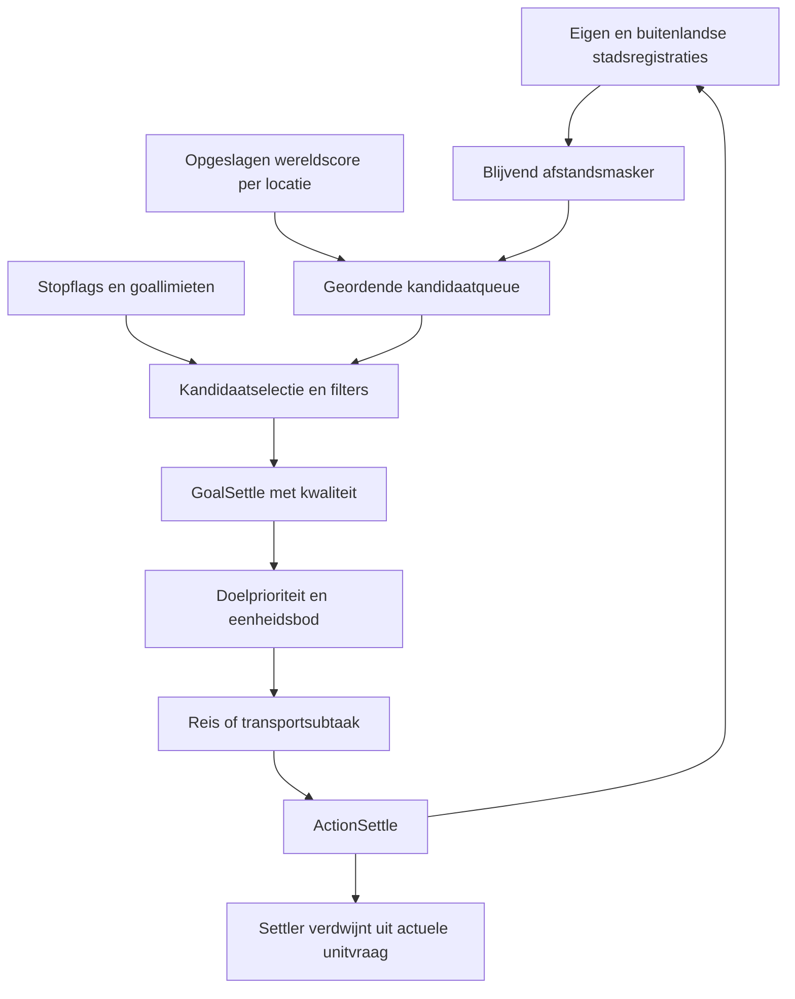

# Samenhang van de bestaande AI-beslisketens

Stand: 4 oktober 2026, fase A. Dit overzicht hergebruikt gecontroleerde analyses en benoemt open schakels. Het beschrijft bestaande werking en bekende afhankelijkheden; de gewenste gezamenlijke opening en stadstypen zijn geen reeds aanwezige implementatie. Voor dekking, bewijssoorten en onderzoeksvolgorde zie [DEKKING.md](DEKKING.md).

Een bestandsregel levert een wens of instelling, niet automatisch een uitgevoerde spelactie. Machinecode verklaart een algoritme; offline controles en gespeelde waarnemingen hebben ieder een beperkter bereik. Er is voor dit document geen spel gestart of gameplay gewijzigd.

## 1. Van bestanden en persoonlijkheid naar effectieve plannerinstellingen

De aanwezige route is personality → main → init, beginturn, diplomatie-events en endturn. Er zijn normale Cleric-, Slaver-, SciFew-, SciMany-, WarFew- en WarMany-routes, naast Default en Barbarians. De generieke main/beginturn-bestanden zijn templates met uitgecommentarieerde onderdelen; zij mogen niet als de actieve route voor iedere speler worden gelezen.

Beginturn-varianten stellen persoonlijkheidsflags in en nemen inputs/outputs, gedeelde economische regels en aiploader op. Engine-inputs beschrijven onder meer stadsantal, economie, beurttoestand, buitenlanders en continentvolheid. De FLI-regels vragen resourcegewichten, WGF/PW, regeringwensen en AIP-modes aan. De AIP-bestanden leveren goalprioriteiten/-grenzen en lijsten voor units, gebouwen, wonders en advances.

| Schakel | Bekend | Nog onbekend |
| --- | --- | --- |
| Spelinitialisatie → persoonlijkheid | Routes en bestanden zijn geïnventariseerd (T). | Werkelijke selectie per speler en hoe die uit een save wordt hersteld. |
| Input → fuzzy wensen | Set-definities, regels en een aantal inputbindings/berekeningen zijn bekend (T/B). | Algemene evaluatie, defuzzificatie, conflicterende schrijvers en precieze tijdsvolgorde. |
| Wensen → AIP-loads | Loadercondities/veldmatrix (T), switchwerking, aparte actionpass, gedeeltelijke vervanging en behoud/save (B/E); zie [AIP-LAADWERKING](AIP-LAADWERKING.md). | Volledige fuzzy evaluatie/defuzzificatie en de concreet uitgevoerde aanvragen van iedere benchmarkbeschaving. |
| Effectieve AIP → goals | Quota-/limietberekening en aanvullende unitbouwdoelen zijn gevolgd (B). | Het volledige gecombineerde profiel in de bestaande T60-saves. |

Bronnen: [ARCHITECTUUR](ARCHITECTUUR.md), [QUOTA-EN-OVERRIDES](QUOTA-EN-OVERRIDES.md), [declaraties](INVENTARIS/declaraties.md) en [profielmatrix](INVENTARIS/profiel-velden.csv). Voor savegedrag zijn scorecache en maskers wel specifiek bewezen; dat mag niet worden uitgebreid tot alle AIP-/FLI-toestand.

## 2. Economie en groei verbinden alle keuzes

Terrein, bevolking, gebouwen en regering vormen de economische mogelijkheden. FLI vraagt gewichten voor voedsel/productie/goud/science, workday/wages/rations, PW-belasting, budget en readiness. Die keuzes beïnvloeden op hun beurt uitbreiding, gebouwtijd, onderzoek, geluk en militaire inzet. De `opening_game_strategy` is een economische vlag uit set_food_or_prod; andere regels gebruiken haar voor groei/PW/wegen/bevolkingswensen. Zij is geen aangetoonde status 'nog geen 30 steden'.

De huidige-opbrengsthelpers in de scoreketen lezen gebonden food/shield/goldvelden en terreinmodificaties. Dit bewijst de betekenis van die velden, maar niet de netto opbrengst van een hele stad. De engine combineert centrum, gewerkt terrein, consumptie, modifiers en kosten; de volgorde en afronding van die combinatie zijn nog niet volledig gevolgd.

Een settler heeft basiskosten 540 en de flag die bij bouwen een inwoner verwijdert. De silo heeft eveneens basiskosten 540, onderhoud 1 en flagwaarde 50. Daarmee zijn beide economisch gekoppeld aan groei. De betekenis van de groeivoorraad na silo/settler en de volgorde van groei en voltooiing zijn nog open. De voorlopige formule `ceil(540/P)` beschrijft uitsluitend productie bij constant netto P zonder verdere effecten; zij voorspelt geen werkelijke Deity-kolonistencyclus.

De ruwe specialistbonus is 10 en worker/scientist Hunger is 10 in Pop.txt. De rationsberekening en automatisch centrumvoedsel in het eerdere stadsmodel zijn H, geen afgeronde engineformule. Daardoor is nog niet bewezen dat één gekozen voedselwerker onder alle relevante instellingen vier inwoners kan onderhouden.

Bronnen: [EARLY-GAME](../ANALYSE-EARLY-GAME.md), [STADSMODELLEN](../ANALYSE-STADSMODELLEN.md) en [LOCATIEKWALITEIT](LOCATIEKWALITEIT.md). Open eindketen: economische wens → per-stadtoewijzing → nettovoedsel/productie/science → groei/voltooiing → nieuwe beurtinput. Savegedrag van voedsel-/productievoorraden en deze eventvolgorde is in de huidige analyses nog niet uitgewerkt.

## 3. Onderzoek en regering koppelen terug naar vestigingsruimte

Onderzoekslijsten staan in persoonlijkheids-AIPs; onder meer citywall_science bevat een afwijkende lijst. Regeringvoorkeur ligt afzonderlijk in set_govern.fli. De originele weinig-stedenregel vraagt Tyranny; Theocracy komt niet in iedere normale persoonlijkheidsrangorde voor. Een gedeelde Religion/Theocracy-opening staat dus in de projectopdracht, niet als universele bestaande AI-route.

Advance.txt maakt Religion → Theocracy een directe prerequisiteketen met basiskosten 65 en 65 (totaal 130; eerdere Religionwaarde 20 gecorrigeerd). Govern.txt geeft onder meer TOO_MANY_CITIES_THRESHOLD 10 voor Tyranny, 20 voor Monarchy en 40 voor Theocracy. Dit zijn parameters, geen bewezen volledige overstap-/gelukformule of effectieve Deity-onderzoekskosten.

Wel B-bewijs: de beginbeurt schrijft `city_delta = max_cities_before_penalty - num_cities`. Negatieve city_delta-sets kunnen via de loader no_settle aanvragen. Daarmee bestaat een terugkoppeling van de engine-marge naar vestigingsgoals, onafhankelijk van settlerbouw. De marge is nog niet volledig aan de regeringstable gekoppeld; de feitelijke fuzzy schakeldrempel mag niet als 'bij stad 11 stopt Tyranny' worden vastgezet.

Aanvulling 4 oktober 14:02: [ONDERZOEK-EN-REGERINGSKEUZE](ONDERZOEK-EN-REGERINGSKEUZE.md) bewijst de lijstselectie en fallback met 14 offlinecontroles. De eerste direct onderzoekbare advance binnen de tijdslimiet wint; anders de eerste direct onderzoekbare als fallback. Lopend onderzoek blijft bij alleen een AIP-switch staan. De gewone regeringspoll kiest de laagste positieve rang, met de eerste database-index bij gelijkstand, na beschikbaarheids-/stadsaantal-/economische filters. Enginewisselingen kennen een Anarchy- en directe tak. Open: namen van twee filtervelden, precieze overgangscontext en netto science-/kostenberekening. De huidige FLI-inventaris toont geen betrouwbare specifieke Theocracy-statusinput; governmentwensen zijn geen terugmelding. Communism/Fascism delen aantoonbaar een rangbuffer, waarvan de fuzzy gevolgen nog onderzocht moeten worden.

Bronnen: [EARLY-GAME](../ANALYSE-EARLY-GAME.md), [VESTIGINGSDOELEN](VESTIGINGSDOELEN.md) en de beschrijving van beperkingen in [GEDEELDE-OPENING](GEDEELDE-OPENING.md). De daarin opgenomen nieuwe bestandsnamen en overgangsregels zijn historische voorstellen, geen bestaande werking.

## 4. Eenheidsvraag is een afzonderlijke keten van vestigingsvraag

De gecontroleerde volgorde in AIP::Update is Update_Actual_Units → Update_Desired_Units → Add_Supplemental_Unit_Build_Goals (calls 20066b7a/81/88). Bestaande eenheden en eenheden in stadsproductie tellen mee. De gewenste bijdrage van een lijst is bij negatief q `ceil(abs(q))`, anders `ceil(q * max(1, stadsantal))`; klassen/lijsten kunnen bijdragen combineren.

Voor een positief verschil gewenst minus actueel worden aanvullende unitbouwdoelen gemaakt. De bouwklasse heeft een eigen prioriteit; 'primary' is geen speciaal settlertype of verplichte eerst af te werken reeks. Een settler die een stad sticht verdwijnt uit de actuele unitvraag en kan zo opnieuw een tekort laten ontstaan. Dit is geen einddoel voor het aantal steden.

Er bestaan unitkeuze-/bouwbaarheidscontroles: Choose_Unit_From_List behoudt de laatste databasegeschikte lijstentry; CityAgent::CanBuildUnit controleert vervolgens stadsvoorwaarden, waaronder oceaanaansluiting voor relevante eenheden. Aangevraagde quota garanderen dus geen productie in elke stad.

De no_settling-output kan boven 0.8 aanvullende doelen voor bepaalde unittypes onderdrukken; de indirecte typepredicate is nog niet volledig benoemd. De naam/context wijst op settlers, maar is geen reden om dit gelijk te stellen aan alle vestigingsstops.

Bron: [RUIMTE-BUREN-TRANSPORT](RUIMTE-BUREN-TRANSPORT.md) met onderliggende adressen. Niet volledig gevolgd: prioriteitsberekening van ieder concurrerend gebouw/wonder/unitdoel, stadstoewijzing en de acceptatie in de daadwerkelijke queue. Primary/core-verweving en scoreverdubbeling zijn voorlopig C uit lokale AIP-commentaren.

## 5. Van toegestane locatie naar gestichte stad

Dit is de meest diepgaand onderzochte keten:

Het statische land-/ruimtemasker begint met enen. Eigen stadsregistratie wist een gesloten intern vierkant met integerconversie van max(1, packing); buitenlandse stadsregistratie gebruikt vaste radius 3. Maskers worden geserialiseerd. De planner kopieert ze per planronde naar werkmaskers, die aanvullende tijdelijke uitsluitingen krijgen. Een nieuwe packing herstelt bestaande nullen bij laden niet vanzelf. Het CityDied-event opent radius 2 zonder volledige herbeoordeling van overlappende uitsluitingen.

De kandidaatqueue leest de enginekwaliteit via World-offset 0x168. De wereldscore beoordeelt twintig omgevingsvakjes plus centrum: productie/goud met voedselgroepsweging, een multiplier voor aanwezigheid van goods en twee centrumvoorwaarden. Zij vergelijkt geen good-identiteiten en voorspelt geen toekomstige improvements in de gevolgde route. De double-formule is met 68 synthetische machinecodecontroles bevestigd; integerconversie en alle grensgevallen vallen niet onder die controle. De tabel is opgeslagen/hersteld met twee afzonderlijke archiefcontroles.

GroundBuildSettleTree en InsertBestSettleGoal verwerken maskers, intern zoekbereik, enginechecks, bezetting en continenttellingen. Een positieve kwaliteit komt in GoalSettle. De latere score combineert algemene prioriteit, ArmyGoal-termen, kwaliteit × settle_value_coef en typebonus. De kwaliteit ordent dus al kandidaten vóór doelen concurreren; een hogere latere modifier kan een eerder verworpen of niet gekozen locatie niet vanzelf terugbrengen.

De goallimieten zijn negatief vast/positief per stad, met afzonderlijke sentinel. Default -80/-5 betekent 80 evalueren/5 uitvoeren; yes_settle -30/-5 geeft 30/5; no_settle 0/0 schakelt beide uit. Dit zijn geen stadsmaxima of garanties op vijf stichtingen per beurt. Naast die AIP-stop heeft InsertSettleGoals een aparte no_settle-binding >0.99. Die is verschillend van no_settling en no_settling_aip.

Eenheden beoordelen bereikbaarheid en doen een bod. Settle_patience werkt in een rekenfactor, niet als directe wachtbeurten. Er bestaat een aankomstpad voor ActionSettle en een transportsubtaak voor TryToBoardTransport. Onbekende statuswaarden, enginechecks en schedulerrondes blijven open, evenals de precieze interne/zichtbare coördinaten, cachevernieuwing, juridische stichting en zichtbaarheid. De scorefootprint is niet zelfstandig bewijs van het werkbare stadsgebied.

Bronnen: [VESTIGINGSDOELEN](VESTIGINGSDOELEN.md), [VESTIGINGSMASKER](VESTIGINGSMASKER.md), [LOCATIEKWALITEIT](LOCATIEKWALITEIT.md), [SCORECACHE-EN-INGREEPPUNTEN](SCORECACHE-EN-INGREEPPUNTEN.md).

## 6. Terrein, bevolking en gebouwen moeten samen worden gelezen

De terreinbestanden geven basisaantallen, additive environmentwaarden, improvementkosten en techvoorwaarden. Gewone bergen hebben productie 20, en mijnniveaus geven in het voorlopige terreinmodel 35/50/65. De tweede voedselniveaus op shallow water en grassland zijn bij respectievelijk Ocean Faring en Agricultural Revolution beschikbaar; de spelnaam alleen bepaalt niet het level. De volledige huidige celopbrengst en upgradevervanging moeten nog worden gebonden.

De AI heeft algemene pop_food/pop_production/pop_science-gewichten en interne per-stadplaatsingsfuncties. Functienamen zoals PlaceAllPop en CalcScientistUtility leveren aanknopingspunten, nog geen gereconstrueerd algoritme of bewezen per-stadoverride. Hetzelfde geldt voor verbeteringwensen inst_food/inst_prod: een hoge waarde is geen opdracht aan een specifieke berg of voedseltile.

Academy/Publishing House/University hebben verschillende knowledgeflags, science-per-popflags, kosten en upkeep. De effecten op specialists, stapeling en nettowetenschap zijn nog niet afgerond. POP_WISEMAN heeft IMPROVEMENT NULL in de definitie; 'scientists pas na academy' is daarom niet bewezen als engine-unlock. Het is onze strategische timingafspraak zolang verdere voorwaarden niet onderzocht zijn.

Open eindketen: terrein en gebouwtoestand → minimumfood/-productie → tile- en specialistutility → bevolkingsactie → nette opbrengst/groei → investering in improvements of gebouwen. Zonder die binding blijven drie bergen/één voedselwerker en drie-vier-vijf voedselwerkers gewenste modellen, geen geïmplementeerde AI-stadstypen.

Bronnen: [STADSMODELLEN](../ANALYSE-STADSMODELLEN.md), [ARCHITECTUUR](ARCHITECTUUR.md) en [TECHNISCHE-UITVOERBAARHEID](../TECHNISCHE-UITVOERBAARHEID.md). De begonnen terrain-food-bewijsbestanden hebben nog geen afgerond semantisch eindrapport.

## 7. Handel heeft identiteit beschikbaar, maar voorraad en routes zijn nog open

De bestaande locatiescore telt alleen good-aanwezigheid. De afzonderlijke World-interface op offset 0xb4 geeft echte GOOD_INDEX terug; die waarde is aan de actuele parser en recordtoewijzing gebonden. De handels-AI FindUnconnectedGoods vraagt via Player-offset 0xb8 tellingen per stad en good-type op. De betekenis van beide tellingen is nog niet afgerond.

Daarmee is de eerste schakel beschikbaar: good op kaart → identiteit. De verdere keten lokale collectie → eigen totale voorraad → import/export en reservering → route-/bestemmingsbod → aanleg → monopolyopbrengst moet nog worden gevolgd. Een globale identiteit verschilt van het lokale good-slot dat de score gebruikt. De gebruikersregel monopoly plus vier extra goods is een strategische afspraak; routecapaciteit en enginebeperkingen zijn nog geen volledig afgeleid handelsmodel.

Labyrinth kost 2160 basisproductie, vereist Ship Building en heeft FREE_TRADE_ROUTES tot de obsoletevoorwaarde Age of Reason. Het heeft daarmee een potentiële koppeling aan routekosten. Die flag bewijst nog geen werkelijke opbrengst in onze benchmark of optimale wonderprioriteit. De werking van goudgebouwen op handel moet eveneens apart worden bepaald.

Bronnen: [SCORECACHE-EN-INGREEPPUNTEN](SCORECACHE-EN-INGREEPPUNTEN.md), [LOCATIEKWALITEIT](LOCATIEKWALITEIT.md) en [EARLY-GAME](../ANALYSE-EARLY-GAME.md). Save-/updategedrag van voorraden, reserveringen en handelsdoelen is nog niet uitgewerkt.

## 8. Marine en defensie reageren op andere signalen dan vestigingskwaliteit

ComputeLandContinentFull gebruikt eigen steden en settlerlegers plus conditioneel buitenlandse steden. Zij berekent een begrensde gewogen bezettingsmaat, geen telling van goede bereikbare vestigingslocaties. De engine-continentmaat is nog niet exact benoemd. Naval wordt bij land_continents_full_of_friends >0.65 gevraagd, supernaval >0.9; beide aanvragen kunnen tegelijk relevant zijn. De friendnaam is niet bewezen gelijk aan formele alliantie.

De nominale zeeklasse stijgt van 5000 naar 6000, tegenover primary-settlers 10500. Quota en klasseprioriteit zijn aparte factoren. Bouwbaarheid en beschikbare technologie komen erbij. Een hogere eilandbonus creëert geen schip, en nul bij afzonderlijke TRANSPORT_GOALS bewijst door het aangetoonde settlertransportpad geen onmogelijkheid van transport.

Foreigner::ComputeLandContinentShared beschrijft spreiding/overlap van eigen en buitenlandse steden; het is geen afstand tot een vijandelijk leger. FSUpdateThreat/CityAgent::UpdateThreat verwerken zichtbare buitenlanders en legers voor HotWar of ColdWar. ColdWar-semantiek is nog niet volledig geduid. Setup_Defense_Goal en GetDefenseRequired vormen lokale defensie. De vroege citywall/survival-FLI kijkt daarentegen onder meer naar de menselijke hoofdstad of beste menselijke speler; dat is geen algemene openingregel voor iedere AI-buur.

Open: strategische dreigingskaart, diplomatieclassificatie, squadmatching/biedingen, transportvraag en capaciteit, inschepen/ontschepen, invasiedoelen, readiness-kosten en effectieve defensie. De aanwezigheid van losse subsystemen bewijst nog geen geslaagde vlootoperatie.

Bron: [RUIMTE-BUREN-TRANSPORT](RUIMTE-BUREN-TRANSPORT.md). AAIP's veranderde unitlijsten en marineclaims zijn gekoppeld in [AAIP-LESSEN](AAIP-LESSEN.md); het eigen effect van die mod is niet met onze drie quota-runs gemeten.

## 9. Wat de bestaande proef wel aan deze ketens koppelt

De gebruiker speelde baseline, -20 en +20 vanaf dezelfde T0-save tot T60. De analyse van alle zeven AI's, zonder human, registreerde 49/66/66 steden en 3/71/78 losse settlers. Welsh hadden 7/3/3 steden en 3/0/0 Triremes. Military Support Cost verschilde sterk. Dit is R-bewijs van veranderde eindtoestanden; actief profiel, doelen, afgewezen biedingen, technologie, netto research en individuele opdrachten zijn niet uitgelezen.

De quotaformule B verklaart waarom beide tekens veel blijvende vraag kunnen geven. De hypothese dat die vraag transportschepen verdrong past bij de uitkomsten en nominale prioriteiten; zij is geen bewezen volledige oorzaak. Stadsbezitverschil, onder meer Kashgar, betekent bovendien dat eindstedenaantallen niet uitsluitend eigen stichting meten.

De saves zijn bruikbaar voor geobserveerde gevolgen. Voor een latere andere packing/scorevergelijking moeten opgeslagen maskers, cache en effectieve nieuwe instellingen worden meegenomen. Bewijs: [VERGELIJKING-T60](../PROEVEN/settlerquota/reeks/VERGELIJKING-T60.md) en [STARTMANIFEST](../PROEVEN/settlerquota/vaste-start/STARTMANIFEST.md).

## 10. Latere stadia en de analyseoverdracht

Technologieën brengen nieuwe improvements, gebouwen, units, regeringen en sea/space-settlingmogelijkheden. De parameters bestaan, maar de latere doorwerking naar bevolking, stadstaak, routes, pollution, defensie en overheidskeuze is nog niet samenhangend geanalyseerd. Een early-gameverbetering bewijst daarom geen blijvend gunstig gedrag na upgrades of stadsverlies.

Voor fase B zijn vooral effectieve profielwerking, economy/growth, research/regering, daadwerkelijke bouwkeuze, bevolking/improvementactie en handelsvoorraad nog essentieel. De vestigingsketen levert al veel gecontroleerde bouwstenen, maar ook daar blijven updatevoorwaarden, beschikbare informatie en matching open. Dit pakket is de eerste overdrachtsinventaris binnen fase A; de volledige analysefase is nog niet afgerond.
