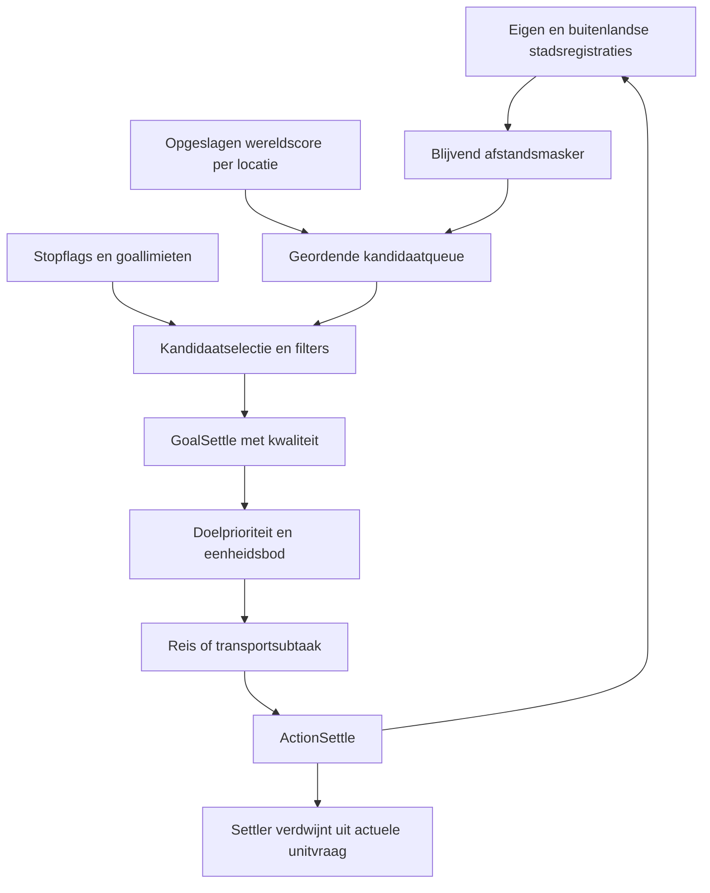

# Samenhang van de bestaande AI-beslisketens

Vervolg7 oktober19:38: [diplomatie/marine](DIPLOMATIE-EN-MARINEVEILIGHEID.md) verbindt sharedland/regard/formele relatie/agreement→FLI/context-/hotcoldselectie→aanval/transportpadkosten→concrete bombardquery/-actie en serialisatie,27 lokale controles. Leave-lands-padkosten zijn geen generieke veiligheidsscore; gewone aanval kan dezelfde transportketen gebruiken als vestiging. De brede analyse is via [OVERDRACHT-A-NAAR-B](OVERDRACHT-A-NAAR-B.md) overgedragen; runtime/scheduler/order/combat- en uitvoerbaarheidsgrenzen blijven expliciet.

Vervolg7 oktober19:29: [fuzzybeleid](FUZZY-BELEID-EN-DEFUZZIFICATIE.md) verbindt setvorm/inputmembership→AND/OR/hedges→regelgewicht/outputprocedures→maximumaggregatie/centroid→symboolpointer→actionpass,26 aanvullende controles naast8 eerdere. Sectionresetwaarden en outputcounters zijn onderbouwd; latere tekstvakken over onbekende algemene defuzzificatie zijn historisch. Een positieve enkelvoudige ja-consequent wordt rond1, ook bij activatie1/3; geen actiegrens gelijkstellen aan inputsterkte. Effectieve benchmarkprofielen en volledige parser/eventvolgorde blijven open.

Vervolg6 oktober16:55: [pollution](POLLUTION-EN-LATERE-STADSTAKEN.md) verbindt opgeslagen populatie/productie/tech/gebouwen/regering→lokale bron en event→dirtyqueue→PWreserve/eligibility→opruimrequest,16 controles. [Bards](BARDS-EN-GELUKSVOORWAARDEN.md) verbindt actuele niet-bardgeluksinput+gecachet bardaantal→callergrens/inwoners→specialistrequests,8 controles. [Fuzzydefuzzificatie](FUZZY-BELEID-EN-DEFUZZIFICATIE.md) verbindt membershipsamples→centroid→gelinkte symboolwaarde; onder epsilon behoud,4 controles. Volledige rule/profieluitkomst blijft open.

Vervolg6 oktober16:49: [GELUKSGEBOUWEN-EN-GARNIZOEN](GELUKSGEBOUWEN-EN-GARNIZOEN.md) verbindt EXERTS_MARTIAL_LAW/getelde units→regeringsmax/effect→cap80, vervolgens aanwezige gebouwbits→vaste/switchregeringsbonus→Happy+78;17 controles. [HANDELSCAPACITEIT-EN-LABYRINTH](HANDELSCAPACITEIT-EN-LABYRINTH.md) verbindt caravanpunten→total−used→AI-routepoort→enginevrijstelling/registratie/rollback/release;23 controles. Labyrinth laat engine-overflow toe maar de AI stopt vooraf bij ruwe capaciteit≤0; global Age-of-Reason-kennis maakt de vrijstelling ongeldig. Geen end-to-end gameplayclaim.

Vervolg6 oktober16:39: [GELUK-WGF-EN-STADSOMVANG](GELUK-WGF-EN-STADSOMVANG.md) verbindt difficulty/regering/bevolking -> stads-/size-/WGF-componenten -> geluksobject; bestaande WGF-optimalisatie kiest discrete kandidaatstanden,19 originele fragmentcontroles. [DEITY-KOSTEN-EN-TECHNOLOGIEFASEN](DEITY-KOSTEN-EN-TECHNOLOGIEFASEN.md) verbindt bekende advances/SCIENCE_HANDICAP -> researchkorting en technologievoorwaarden -> age -> queuekorting/opgeslagen kosten -> completiondrempel,66 controles. Beide pakketten houden volledige beurt-/scheduler-/riotuitzonderingen expliciet open.

Vervolg6 oktober16:26: [MILITAIRE-STEUN-PARAATHEID-EN-PW](MILITAIRE-STEUN-PARAATHEID-EN-PW.md) verbindt unit-SHIELD_HUNGER/READY/wonder -> gezamenlijke legerlast -> stadsgewijze afronding -> resterende productie -> PW-voorraad en bouwproductie,29 controles. Settlerhunger0; hogere queuekosten betekenen geen hogere militaire ondersteuning. De bestaande openingreadiness en PW-regels kunnen dezelfde productie raken. Tekort-/HP-/gelukcontext en de volledige fuzzy uitkomst blijven open.

Vervolg5 oktober17:23: [ONDERHOUD-LONEN-EN-DEITY-INKOMSTEN](ONDERHOUD-LONEN-EN-DEITY-INKOMSTEN.md) verbindt aanwezige gebouwrecords/vrijstellingsgrens → onderhoud/kas, populationfilter/wagesstand → betaling/loonlast en bestaande difficulty-inkomstencorrectie → ledgerherberekening,19 controles. [IMPROVEMENTCONSTRUCTIE-EN-STADSGEBIED](IMPROVEMENTCONSTRUCTIE-EN-STADSGEBIED.md) verbindt twintig kandidaatvakjes/werkplekfilters → installatieutility/hoogste positieve kandidaat → request/projectaanmaak → echte PW-afschrijving en lokale levelbits,25 controles. Finale populationplaatsing, projecttiming/refresh, volledige veiligheid/geluk/ondersteuning blijven open.

Vervolg5 oktober17:10: [DIRECTE-WETENSCHAP-EN-SCIENCEGEBOUWEN](DIRECTE-WETENSCHAP-EN-SCIENCEGEBOUWEN.md) verbindt populationbonus/SCIENCE_PER_POP → knowledgegebouwen → regering/wonder → CityData+2c → Player+11e4 → onderzoeksvoorraad. Die directe bijdrage wordt na de cash-sciencefactor toegevoegd, zonder tweede regeringsvermenigvuldiging.13 originele controles. [TRANSPORT-EN-VESTIGINGSACTIES](TRANSPORT-EN-VESTIGINGSACTIES.md) verbindt GoalSettle/overgeërfde uitvoering → capaciteit/carrierselectie → boarding/debarking/vestigingsrequests,23 controles. Requestuitgifte is geen bewijs van voltooide reis/stadcreatie. Nog geen volledige scheduler, veiligheid of lasten-/beurtcyclus.

Stand: 4 oktober 2026, fase A. Dit overzicht hergebruikt gecontroleerde analyses en benoemt open schakels. Het beschrijft bestaande werking en bekende afhankelijkheden; de gewenste gezamenlijke opening en stadstypen zijn geen reeds aanwezige implementatie. Voor dekking, bewijssoorten en onderzoeksvolgorde zie [DEKKING.md](DEKKING.md).

Een bestandsregel levert een wens of instelling, niet automatisch een uitgevoerde spelactie. Machinecode verklaart een algoritme; offline controles en gespeelde waarnemingen hebben ieder een beperkter bereik. Er is voor dit document geen spel gestart of gameplay gewijzigd.

## 1. Van bestanden en persoonlijkheid naar effectieve plannerinstellingen

De aanwezige route is personality → main → init, beginturn, diplomatie-events en endturn. Er zijn normale Cleric-, Slaver-, SciFew-, SciMany-, WarFew- en WarMany-routes, naast Default en Barbarians. De generieke main/beginturn-bestanden zijn templates met uitgecommentarieerde onderdelen; zij mogen niet als de actieve route voor iedere speler worden gelezen.

Beginturn-varianten stellen persoonlijkheidsflags in en nemen inputs/outputs, gedeelde economische regels en aiploader op. Engine-inputs beschrijven onder meer stadsantal, economie, beurttoestand, buitenlanders en continentvolheid. De FLI-regels vragen resourcegewichten, WGF/PW, regeringwensen en AIP-modes aan. De AIP-bestanden leveren goalprioriteiten/-grenzen en lijsten voor units, gebouwen, wonders en advances.

| Schakel | Bekend | Nog onbekend |
| --- | --- | --- |
| Spelinitialisatie → persoonlijkheid | Routes en bestanden zijn geïnventariseerd (T). | Werkelijke selectie per speler en hoe die uit een save wordt hersteld. |
| Input → fuzzy wensen | Set-definities, regels en een aantal inputbindings/berekeningen zijn bekend (T/B). | Algemene evaluatie, defuzzificatie, conflicterende schrijvers en precieze tijdsvolgorde. |
| Wensen → AIP-loads | Loadercondities/veldmatrix (T), switchwerking, aparte actionpass, gedeeltelijke vervanging en behoud/save (B/E); zie [AIP-LAADWERKING](AIP-LAADWERKING.md). | Volledige fuzzy evaluatie/defuzzificatie en de concreet uitgevoerde aanvragen van iedere benchmarkbeschaving. |
| Effectieve AIP → goals | Quota-/limietberekening en aanvullende unitbouwdoelen zijn gevolgd (B). | Het volledige gecombineerde profiel in de bestaande T60-saves. |

Bronnen: [ARCHITECTUUR](ARCHITECTUUR.md), [QUOTA-EN-OVERRIDES](QUOTA-EN-OVERRIDES.md), [declaraties](INVENTARIS/declaraties.md) en [profielmatrix](INVENTARIS/profiel-velden.csv). Voor savegedrag zijn scorecache en maskers wel specifiek bewezen; dat mag niet worden uitgebreid tot alle AIP-/FLI-toestand.

## 2. Economie en groei verbinden alle keuzes

Terrein, bevolking, gebouwen en regering vormen de economische mogelijkheden. FLI vraagt gewichten voor voedsel/productie/goud/science, workday/wages/rations, PW-belasting, budget en readiness. Die keuzes beïnvloeden op hun beurt uitbreiding, gebouwtijd, onderzoek, geluk en militaire inzet. De `opening_game_strategy` is een economische vlag uit set_food_or_prod; andere regels gebruiken haar voor groei/PW/wegen/bevolkingswensen. Zij is geen aangetoonde status 'nog geen 30 steden'.

De huidige-opbrengsthelpers in de scoreketen lezen gebonden food/shield/goldvelden en terreinmodificaties. Dit bewijst de betekenis van die velden, maar niet de netto opbrengst van een hele stad. De engine combineert centrum, gewerkt terrein, consumptie, modifiers en kosten; de volgorde en afronding van die combinatie zijn nog niet volledig gevolgd.

Een settler heeft basiskosten540 en BUILDING_REMOVES_A_POP, gebonden aan UnitRecord+40 bit4000. De normale singleplayer-AI kan ook bij grootte1 voltooien. Met de bestaande instelling AIPopCheat=Yes slaat zij bevolkingsverlies en groeivoorraad-aftrek over; zonder vrijstelling wordt integer(CITY_GROWTH_COEFFICIENT) van de groeivoorraad afgetrokken, minimum0, plus één inwoner verwijderd. De silo kost eveneens540, onderhoud1; haar buffer met maximum50 staat afzonderlijk van de groeivoorraad. Na groei met silo blijft de helft van de nieuwe basisdrempel staan. Zie [VOEDSEL/GROEI](VOEDSEL-GROEI-EN-KOLONISTEN.md): 24 groeicontroles en14 settlercontroles met expliciete mocks. Volledige consumptie, modifiers, beurtvolgorde en benchmarkinstellingen blijven open. `ceil(540/P)` beschrijft alleen productie bij constant netto P, geen werkelijke Deity-kolonistencyclus.

De ruwe specialistbonus is 10 en worker/scientist Hunger is 10 in Pop.txt. De rationsberekening en automatisch centrumvoedsel in het eerdere stadsmodel zijn H, geen afgeronde engineformule. Daardoor is nog niet bewezen dat één gekozen voedselwerker onder alle relevante instellingen vier inwoners kan onderhouden.

Bronnen: [EARLY-GAME](../ANALYSE-EARLY-GAME.md), [STADSMODELLEN](../ANALYSE-STADSMODELLEN.md) en [LOCATIEKWALITEIT](LOCATIEKWALITEIT.md). Open eindketen: economische wens → per-stadtoewijzing → nettovoedsel/productie/science → groei/voltooiing → nieuwe beurtinput. Savegedrag van voedsel-/productievoorraden en deze eventvolgorde is in de huidige analyses nog niet uitgewerkt.

## 3. Onderzoek en regering koppelen terug naar vestigingsruimte

Onderzoekslijsten staan in persoonlijkheids-AIPs; onder meer citywall_science bevat een afwijkende lijst. Regeringvoorkeur ligt afzonderlijk in set_govern.fli. De originele weinig-stedenregel vraagt Tyranny; Theocracy komt niet in iedere normale persoonlijkheidsrangorde voor. Een gedeelde Religion/Theocracy-opening staat dus in de projectopdracht, niet als universele bestaande AI-route.

Advance.txt maakt Religion → Theocracy een directe prerequisiteketen met basiskosten 65 en 65 (totaal 130; eerdere Religionwaarde 20 gecorrigeerd). Govern.txt geeft onder meer TOO_MANY_CITIES_THRESHOLD 10 voor Tyranny, 20 voor Monarchy en 40 voor Theocracy. Dit zijn parameters, geen bewezen volledige overstap-/gelukformule of effectieve Deity-onderzoekskosten.

Wel B-bewijs: de beginbeurt schrijft `city_delta = max_cities_before_penalty - num_cities`. Negatieve city_delta-sets kunnen via de loader no_settle aanvragen. Daarmee bestaat een terugkoppeling van de engine-marge naar vestigingsgoals, onafhankelijk van settlerbouw. De marge is nog niet volledig aan de regeringstable gekoppeld; de feitelijke fuzzy schakeldrempel mag niet als 'bij stad 11 stopt Tyranny' worden vastgezet.

Aanvulling 4 oktober 18:41: [ONDERZOEK-EN-REGERINGSKEUZE](ONDERZOEK-EN-REGERINGSKEUZE.md) bewijst lijstselectie en fallback met14 offlinecontroles. De eerste direct onderzoekbare advance binnen de tijdslimiet wint; anders de eerste direct onderzoekbare als fallback. Lopend onderzoek blijft bij alleen een AIP-switch staan. De gewone regeringspoll kiest de laagste positieve rang, met de eerste database-index bij gelijkstand, na beschikbaarheids-/stadsaantal-/economische filters. TOO_MANY_CITIES_THRESHOLD blokkeert Theocracy als kandidaat vanaf40 steden; GOLD_COEF1→1.25 blokkeert Tyranny→Theocracy niet in de dalende-goudtak. De normale wissel gaat via Anarchy, deadline1–4 rondes later; herhaald aanvragen behoudt de deadline. Player+11e0 betekent afronding in deze ronde en laat dan een directe verdere wissel toe.13 offline overgangscontroles slagen. Open: gevolgen van toepassing/Anarchy, netto science en kostenberekening, overige load-events. De FLI-inventaris toont geen betrouwbare specifieke Theocracy-statusinput; governmentwensen zijn geen terugmelding. Communism/Fascism delen een rangbuffer met nog open fuzzy gevolgen.

Bronnen: [EARLY-GAME](../ANALYSE-EARLY-GAME.md), [VESTIGINGSDOELEN](VESTIGINGSDOELEN.md) en de beschrijving van beperkingen in [GEDEELDE-OPENING](GEDEELDE-OPENING.md). De daarin opgenomen nieuwe bestandsnamen en overgangsregels zijn historische voorstellen, geen bestaande werking.

## 4. Eenheidsvraag is een afzonderlijke keten van vestigingsvraag

De gecontroleerde volgorde in AIP::Update is Update_Actual_Units → Update_Desired_Units → Add_Supplemental_Unit_Build_Goals (calls 20066b7a/81/88). Bestaande eenheden en eenheden in stadsproductie tellen mee. De gewenste bijdrage van een lijst is bij negatief q `ceil(abs(q))`, anders `ceil(q * max(1, stadsantal))`; klassen/lijsten kunnen bijdragen combineren.

Voor een positief verschil gewenst minus actueel worden aanvullende unitbouwdoelen gemaakt. De bouwklasse heeft een eigen prioriteit; 'primary' is geen speciaal settlertype of verplichte eerst af te werken reeks. Een settler die een stad sticht verdwijnt uit de actuele unitvraag en kan zo opnieuw een tekort laten ontstaan. Dit is geen einddoel voor het aantal steden.

Er bestaan unitkeuze-/bouwbaarheidscontroles: Choose_Unit_From_List behoudt de laatste databasegeschikte lijstentry; CityAgent::CanBuildUnit controleert vervolgens stadsvoorwaarden, waaronder oceaanaansluiting voor relevante eenheden. Aangevraagde quota garanderen dus geen productie in elke stad.

De no_settling-output kan boven 0.8 aanvullende doelen voor bepaalde unittypes onderdrukken; de indirecte typepredicate is nog niet volledig benoemd. De naam/context wijst op settlers, maar is geen reden om dit gelijk te stellen aan alle vestigingsstops.

Bron: [RUIMTE-BUREN-TRANSPORT](RUIMTE-BUREN-TRANSPORT.md) met onderliggende adressen. Niet volledig gevolgd: prioriteitsberekening van ieder concurrerend gebouw/wonder/unitdoel, stadstoewijzing en de acceptatie in de daadwerkelijke queue. Primary/core-verweving en scoreverdubbeling zijn voorlopig C uit lokale AIP-commentaren.

## 5. Van toegestane locatie naar gestichte stad

Dit is de meest diepgaand onderzochte keten:

Het statische land-/ruimtemasker begint met enen. Eigen stadsregistratie wist een gesloten intern vierkant met integerconversie van max(1, packing); buitenlandse stadsregistratie gebruikt vaste radius 3. Maskers worden geserialiseerd. De planner kopieert ze per planronde naar werkmaskers, die aanvullende tijdelijke uitsluitingen krijgen. Een nieuwe packing herstelt bestaande nullen bij laden niet vanzelf. Het CityDied-event opent radius 2 zonder volledige herbeoordeling van overlappende uitsluitingen.

De kandidaatqueue leest de enginekwaliteit via World-offset 0x168. De wereldscore beoordeelt twintig omgevingsvakjes plus centrum: productie/goud met voedselgroepsweging, een multiplier voor aanwezigheid van goods en twee centrumvoorwaarden. Zij vergelijkt geen good-identiteiten en voorspelt geen toekomstige improvements in de gevolgde route. De double-formule is met 68 synthetische machinecodecontroles bevestigd; integerconversie en alle grensgevallen vallen niet onder die controle. De tabel is opgeslagen/hersteld met twee afzonderlijke archiefcontroles.

GroundBuildSettleTree en InsertBestSettleGoal verwerken maskers, intern zoekbereik, enginechecks, bezetting en continenttellingen. Een positieve kwaliteit komt in GoalSettle. De latere score combineert algemene prioriteit, ArmyGoal-termen, kwaliteit × settle_value_coef en typebonus. De kwaliteit ordent dus al kandidaten vóór doelen concurreren; een hogere latere modifier kan een eerder verworpen of niet gekozen locatie niet vanzelf terugbrengen.

De goallimieten zijn negatief vast/positief per stad, met afzonderlijke sentinel. Default -80/-5 betekent 80 evalueren/5 uitvoeren; yes_settle -30/-5 geeft 30/5; no_settle 0/0 schakelt beide uit. Dit zijn geen stadsmaxima of garanties op vijf stichtingen per beurt. Naast die AIP-stop heeft InsertSettleGoals een aparte no_settle-binding >0.99. Die is verschillend van no_settling en no_settling_aip.

Eenheden beoordelen bereikbaarheid en doen een bod. Settle_patience werkt in een rekenfactor, niet als directe wachtbeurten. Er bestaat een aankomstpad voor ActionSettle en een transportsubtaak voor TryToBoardTransport. Onbekende statuswaarden, enginechecks en schedulerrondes blijven open, evenals de precieze interne/zichtbare coördinaten, cachevernieuwing, juridische stichting en zichtbaarheid. De scorefootprint is niet zelfstandig bewijs van het werkbare stadsgebied.

Bronnen: [VESTIGINGSDOELEN](VESTIGINGSDOELEN.md), [VESTIGINGSMASKER](VESTIGINGSMASKER.md), [LOCATIEKWALITEIT](LOCATIEKWALITEIT.md), [SCORECACHE-EN-INGREEPPUNTEN](SCORECACHE-EN-INGREEPPUNTEN.md).

## 6. Terrein, bevolking en gebouwen moeten samen worden gelezen

De [terreinbinding](TERREIN-EN-IMPROVEMENTS.md) verklaart de echte indexvolgorde, environmentfamilies en technologiecontrole. Bergen zijn indices 8/20/22. Gewone bergen hebben basisproductie 20; mijnbijdragen zijn 15/30/45. De tweede voedselniveaus op shallow water en grassland vereisen Ocean Faring en Agricultural Revolution. Absolute improvementopbrengst en verschil met het bestaande niveau zijn afzonderlijke interfaces; het verschil trekt alleen het vorige niveau van dezelfde familie af. Dit bewijst geen coexistentie van families na bouwen.43 originele enginecontroles slagen.

De [bevolkingsanalyse](BEVOLKING-EN-SCIENTISTS.md) bindt FSAllocatePopulation→PlaceAllPop→minimumvoorwaarden→tile/specialistutility→Population-aanvraag. Pop_food/pop_production/pop_science zijn gewichten. De actieve route vergelijkt beste beschikbare scientistbonus*(1+knowledgepercent)*Wscience met resterende tiles; gelijkstand kiest tile. Gewichten volgen twee CityList-groepen, geen bewezen productie/science-stadsrollen. Minimumfood gebruikt eerst1 en conditioneel factor−1 met dezelfde teller; minimumproductie stopt bij positieve centrumproductie en vraagt anders hoogstens één tile.27 codecontroles slagen. Verbeteringwensen inst_food/inst_prod zijn eveneens geen opdracht aan een specifieke berg of voedseltile.

Academy/Publishing House/University hebben verschillende knowledgeflags, science-per-popflags, kosten en upkeep. SCIENCE_PER_POP is nu als opgetelde gebouwbijdrage*totale bevolking gebonden, naast de basisscience van inhabitants; knowledgepercent werkt ook in scientistutility en goudomzetting. Volledige nettowetenschap blijft open. POP_WISEMAN heeft IMPROVEMENT NULL; best-specialistfilters lezen eventuele gebouw/size/governmentvoorwaarden. 'Scientists pas na academy' blijft onze strategische timingafspraak, geen aangetoonde algemene engine-unlock.

Open eindketen: terrein en gebouwtoestand → minimumfood/-productie → tile- en specialistutility → bevolkingsactie → nette opbrengst/groei → investering in improvements of gebouwen. Zonder die binding blijven drie bergen/één voedselwerker en drie-vier-vijf voedselwerkers gewenste modellen, geen geïmplementeerde AI-stadstypen.

Bronnen: [TERREIN-EN-IMPROVEMENTS](TERREIN-EN-IMPROVEMENTS.md), [STADSMODELLEN](../ANALYSE-STADSMODELLEN.md), [ARCHITECTUUR](ARCHITECTUUR.md) en [TECHNISCHE-UITVOERBAARHEID](../TECHNISCHE-UITVOERBAARHEID.md). Huidige raw celopbrengsten en AI-kandidaten/getters zijn gebonden; CityData-modifiers, exacte werkbare oppervlakte, bevolkingkeuze en finale constructiekosten blijven open. De analist vervolgt nu de bestaande werker/scientistketen.

## 7. Handel koppelt lokale bewerking aan concentratie

[GOODS-EN-HANDELSROUTES](GOODS-EN-HANDELSROUTES.md) bindt de eerste voorraad-/interne-routeketen. World geeft echte good-identiteit; de engine telt lokale exemplaren uit centrum en gebruikte terreinposities. Uitgaande good-routes verlagen beschikbare voorraad, inkomende verhogen haar; de afzonderlijke lokale telling blijft staan. De Player-interface geeft beide tellingen per stad/type aan de AI.

De basis-goodcomponent is waarde*N*(N+1)/2. Het oorspronkelijke interne AI-bod berekent de marginale gezamenlijke verandering bij verplaatsing: waarde*(bestemmingsvoorraad+1-bronvoorraad), omgerekend naar productie en resterende rondes. De AI waardeert concentratie dus al in de handelsplanner. FindUnconnectedGoods maakt echter slechts een doel per stad/type bij lokaal>0 en lokaal==beschikbaar. De planner voorspelt geen good-voorraad van toekomstige steden; de vestigingsscore vergelijkt geen identiteiten.

Government MAX_INCOMING_TRADE/MAX_OUTGOING_TRADE zijn beide4 in het origineel. De echte parser, Player-capaciteitsinterface en engine-aanmaak binden afzonderlijke import-/exportlijsten aan die grenzen. De gebruikersopzet lokaal exemplaar+vier importen is daarmee verklaard; vijf is geen harde grens voor de totale voorraad.23 originele codecontroles met expliciete mocks slagen, zonder gameplayrun.

Open eindketen: terreinpotentieel/overlap en popplaatsing -> lokale voorraad -> reserveringen/offers/save -> routes en veiligheid/kosten -> good-goud -> gebouwen/regering/crime/science -> netto economie. Goods/govern zijn byte-identiek OG/AAIP; dit bewijst geen gelijkheid van alle handelsaansturing. Labyrinth FREE_TRADE_ROUTES blijft een nog niet volledig gebonden kostenmodifier. De monopoly-threshold50 en buitenlandse handel blijven apart open.

De eerste vervolgschakel naar gebouwen staat in [GOUDGEBOUWEN-EN-STADSINKOMSTEN.md](GOUDGEBOUWEN-EN-STADSINKOMSTEN.md). Gold-percentages worden opgeteld en op het stadsbedrag inclusief handel toegepast, gevolgd door GOLD_COEF en verdere inhoudingen. De AI-percentageutility gebruikt het huidige bedrag na die inhoudingen; de rijksprojectie gebruikt een afzonderlijke input vóór deze inhoudingen. De utility is daardoor geen volledige marginale simulatie.17 codecontroles slagen. Volledige netto-economie, onderhoud, wetenschap en bouwdoelconcurrentie blijven open.

De [rijksallocatie](RIJKSBUDGET-EN-WETENSCHAP.md) vraagt1 zolang advances ontbreken, anders0; de engine clamped op Government.MAX_SCIENCE_RATE. CityData levert goudkosten=gold*ledgerRatio*fractie en science=goudkosten*(1+knowledgepercent). De rijksloop verwerkt beschikbare kas, daarna KNOWLEDGE_COEF, wonder-/extra bijdragen en onderzoeksvoorraad.17 offlinechecks bevestigen aanvraag/cap/CityData-branch; volledige lasten, directe wetenschap en beurtvolgorde blijven open.

De gedeelde inhouding op voedsel/productie/goud is inmiddels [criminaliteit](RANTSOENEN-EN-STADSOPBRENGSTEN.md): stadswonder-/gebouwfactoren en Government.CRIME_COEF/OFFSET werken op de actuele gelukswaarde. Gebouw-crimefactoren vermenigvuldigen; goudpercentages tellen op.26 extra enginechecks binden crime, positionele food/productie met verschillende afronding, en werkdagfactor. Rantsoenbehoefte is afzonderlijk gebonden. Volledige stadssom/consumptie, gelukscomponenten, regeringseffecten elders en beurtvolgorde blijven open.

## 8. Marine en defensie reageren op andere signalen dan vestigingskwaliteit

De bestaande bouwdoelconcurrentie is inmiddels aanvullend verbonden in [BOUWDOELEN-EN-QUEUE.md](BOUWDOELEN-EN-QUEUE.md): categorielijst kiest eerste geschikte item; basis+gewicht vormt bod. Lijstvolgorde en gewicht zijn verschillende ingrepen. Unit/wonderbouwtijd kan blokkeren; gebouwbouwtijd verlaagt alleen gewicht in de gevolgde lijsttak. Lege-queuechecks en echte enginehercontrole scheiden doel van geaccepteerde queue.33 offlinechecks; volledige scheduler en specifieke legaliteitsbranches blijven open. De afzonderlijke transport/vestigingsactieketen wordt nu uitgewerkt.

ComputeLandContinentFull gebruikt eigen steden en settlerlegers plus conditioneel buitenlandse steden. Zij berekent een begrensde gewogen bezettingsmaat, geen telling van goede bereikbare vestigingslocaties. De engine-continentmaat is nog niet exact benoemd. Naval wordt bij land_continents_full_of_friends >0.65 gevraagd, supernaval >0.9; beide aanvragen kunnen tegelijk relevant zijn. De friendnaam is niet bewezen gelijk aan formele alliantie.

De nominale zeeklasse stijgt van 5000 naar 6000, tegenover primary-settlers 10500. Quota en klasseprioriteit zijn aparte factoren. Bouwbaarheid en beschikbare technologie komen erbij. Een hogere eilandbonus creëert geen schip, en nul bij afzonderlijke TRANSPORT_GOALS bewijst door het aangetoonde settlertransportpad geen onmogelijkheid van transport.

Foreigner::ComputeLandContinentShared beschrijft spreiding/overlap van eigen en buitenlandse steden; het is geen afstand tot een vijandelijk leger. FSUpdateThreat/CityAgent::UpdateThreat verwerken zichtbare buitenlanders en legers voor HotWar of ColdWar. ColdWar-semantiek is nog niet volledig geduid. Setup_Defense_Goal en GetDefenseRequired vormen lokale defensie. De vroege citywall/survival-FLI kijkt daarentegen onder meer naar de menselijke hoofdstad of beste menselijke speler; dat is geen algemene openingregel voor iedere AI-buur.

Open: strategische dreigingskaart, diplomatieclassificatie, squadmatching/biedingen, transportvraag en capaciteit, inschepen/ontschepen, invasiedoelen, readiness-kosten en effectieve defensie. De aanwezigheid van losse subsystemen bewijst nog geen geslaagde vlootoperatie.

Bron: [RUIMTE-BUREN-TRANSPORT](RUIMTE-BUREN-TRANSPORT.md). AAIP's veranderde unitlijsten en marineclaims zijn gekoppeld in [AAIP-LESSEN](AAIP-LESSEN.md); het eigen effect van die mod is niet met onze drie quota-runs gemeten.

## 9. Wat de bestaande proef wel aan deze ketens koppelt

De gebruiker speelde baseline, -20 en +20 vanaf dezelfde T0-save tot T60. De analyse van alle zeven AI's, zonder human, registreerde 49/66/66 steden en 3/71/78 losse settlers. Welsh hadden 7/3/3 steden en 3/0/0 Triremes. Military Support Cost verschilde sterk. Dit is R-bewijs van veranderde eindtoestanden; actief profiel, doelen, afgewezen biedingen, technologie, netto research en individuele opdrachten zijn niet uitgelezen.

De quotaformule B verklaart waarom beide tekens veel blijvende vraag kunnen geven. De hypothese dat die vraag transportschepen verdrong past bij de uitkomsten en nominale prioriteiten; zij is geen bewezen volledige oorzaak. Stadsbezitverschil, onder meer Kashgar, betekent bovendien dat eindstedenaantallen niet uitsluitend eigen stichting meten.

De saves zijn bruikbaar voor geobserveerde gevolgen. Voor een latere andere packing/scorevergelijking moeten opgeslagen maskers, cache en effectieve nieuwe instellingen worden meegenomen. Bewijs: [VERGELIJKING-T60](../PROEVEN/settlerquota/reeks/VERGELIJKING-T60.md) en [STARTMANIFEST](../PROEVEN/settlerquota/vaste-start/STARTMANIFEST.md).

## 10. Latere stadia en de analyseoverdracht

Technologieën brengen nieuwe improvements, gebouwen, units, regeringen en sea/space-settlingmogelijkheden. De parameters bestaan, maar de latere doorwerking naar bevolking, stadstaak, routes, pollution, defensie en overheidskeuze is nog niet samenhangend geanalyseerd. Een early-gameverbetering bewijst daarom geen blijvend gunstig gedrag na upgrades of stadsverlies.

Voor fase B zijn vooral effectieve profielwerking, economy/growth, research/regering, daadwerkelijke bouwkeuze, bevolking/improvementactie en handelsvoorraad nog essentieel. De vestigingsketen levert al veel gecontroleerde bouwstenen, maar ook daar blijven updatevoorwaarden, beschikbare informatie en matching open. Dit pakket is de eerste overdrachtsinventaris binnen fase A; de volledige analysefase is nog niet afgerond.
