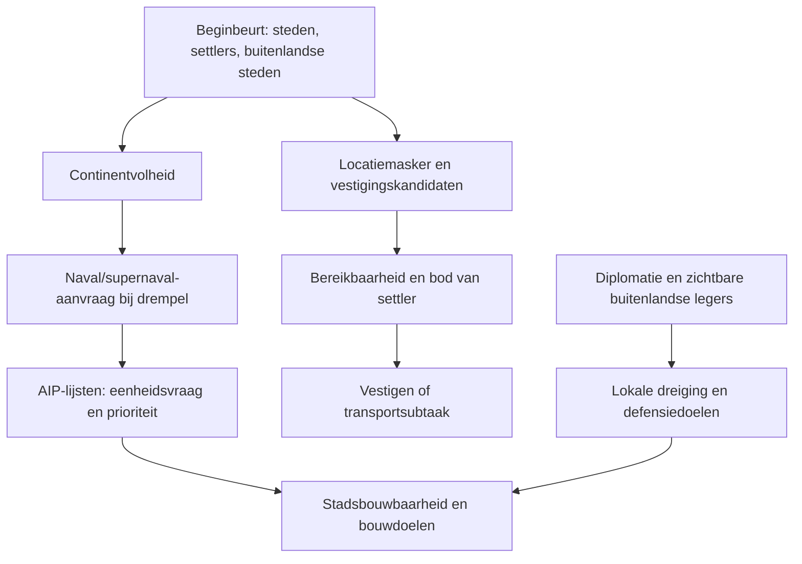

# Ruimte, buren en transport: bestaande beslisketen

Alleen-lezen onderzoek van CTP I op Deity. Geen gameplaybestanden gewijzigd of nieuwe spellen gestart. Deze analyse voert stap 1 van het onderzoeksplan uit; resterende bindings- en runtimevragen staan expliciet hieronder.

## 1. Gewenste eenheden: betekenis van de quota vastgesteld

`AIP::Update_Desired_Units` (200659a0) gebruikt per ingeschakelde bouwklasse de door `Choose_Unit_From_List` geselecteerde eenheid en quota. Voor gewone quota geldt:

| Quota q | Gewenst aantal voor deze klasse |
|---|---|
| q < 0 | ceil(abs(q)), vast aantal |
| q >= 0 | ceil(q × max(1, aantal steden)) |

Bewijs: tekenvergelijking op 20065a75, negatie op 20065a82, vermenigvuldiging met het stadsaantal op 20065a86, afronding op 20065ab0. De bijdragen worden per eenheidstype opgeteld (20065ab6); core en overflow kunnen dus aanvullende vraag leveren.

Daarmee betekent primary −20 twintig settlers; +20 twintig per stad, bijvoorbeeld zestig bij drie steden. Het zijn gewenste eenheden, geen startunits of doel voor het aantal steden. Dat beide T60-varianten dezelfde stedenaantallen opleverden bewijst geen gelijke interpretatie: beide kunnen voldoende onvervulde vraag hebben om langdurig settlerbouw aan te vragen.

`Update_Actual_Units` telt bestaande legers en eenheden in stadsproductie mee (aanroep `What_Army_Am_I_Building` op 2006579f). `Choose_Unit_From_List` loopt door de lijst en behoudt de laatste eenheid die zijn databasecontrole doorstaat. Daarna bestaan afzonderlijke stadscontroles via `CityAgent::CanBuildUnit` (2001f330), met enginevoorwaarden en controles op aangrenzende oceaanvakjes. Een gewenste Trireme is dus niet automatisch bouwbaar in iedere stad. De namen van enkele indirect aangeroepen enginepredicaten zijn nog niet betrouwbaar gebonden.

Bron: [eenheidsvraag](BINAIR/ruimte-eenheidsvraag.txt) en [bouwbaarheid/defensie](BINAIR/ruimte-defensie-bouwbaarheid.txt).

### Aanvullen, geen verplichte reeks van twintig

Aanvullend gecontroleerd: `AIP::Update` roept achtereenvolgens `Update_Actual_Units`, `Update_Desired_Units` en `Add_Supplemental_Unit_Build_Goals` aan (20066b7a/81/88). Laatstgenoemde trekt op 20065d0c–20065d12 **actueel van gewenst** af. Alleen bij een positief tekort maakt de routine aanvullende eenheidsbouwdoelen; zij loopt over alle eenheidstypen, niet uitsluitend settlers. Er is hier geen blokkade 'eerst alle twintig settlers afmaken voordat andere eenheden mogen'. De bouwdoelen concurreren via prioriteiten en stadsvoorwaarden. `no_settling` kan de aanvraag voor de betreffende settlertypen bovendien onderdrukken.

−20 is dus een aan te vullen gelijktijdige behoefte onder het actieve profiel, geen totaal van twintig ooit gebouwde settlers. Vereenvoudigd, zonder aanvullende core/overflow-vraag: bij twaalf bestaande settlers en drie in productie ontbreken er vijf. Als een settler een stad sticht, verdwijnt die uit de eenhedentelling en ontstaat opnieuw een tekort. Een andere actieve lijst kan de doelvoorraad veranderen. 'Primary' is de naam van de bouwklasse met haar eigen prioriteit, geen aparte soort settler.

Bewijs: [aanroepvolgorde](BINAIR/settler-aanvulling-aanroepers.txt), [tekort en bouwdoelen](BINAIR/settler-aanvulling-prioriteit.txt), [eenheidsbouwdoel](BINAIR/settler-aanvulling-bouwdoel.txt). Daarmee is de aanvulling uit code vastgesteld; de precieze productievolgorde per stad is geen gevolg van de quota alleen.

Onderzoeksles: deze berekening had vóór de quotareeks gericht uit de DLL onderzocht moeten worden. Dat had proeven voor de betekenis van het teken en de telling kunnen besparen. De bestaande T60-runs leveren wel afzonderlijk bewijs van gameplay-effecten en transportproblemen; codeonderzoek vervangt niet iedere gedragsmeting.

## 2. Volheid en marineprofielen

De beginbeurt berekent twee afzonderlijke inputs:

- `land_continents_full`, parameter true op 2003558a;
- `land_continents_full_of_friends`, parameter false op 20035599.

`ComputeLandContinentFull` telt eigen steden en aanwezige settlerlegers per continent. Buitenlandse steden tellen mee afhankelijk van de parameter en `IsAtColdWar`: bij false worden buitenlanders waarvoor die predicate true is overgeslagen; bij true niet. Neem het woord 'friends' daarom niet zonder meer over als 'formeel geallieerde spelers'.

De eindberekening gebruikt per bewoond continent een begrensde bezettingsratio en weegt die met de eigen telling. De ratio bevat `(eigen + meegetelde buitenlandse telling) / (engine-continentmaat × 1/14)`, begrensd op 1. De context wijst op continentoppervlakte als die engine-maat, maar de indirecte getter op offset 0x150 is nog niet exact benoemd. Dit is geen telling van werkelijk bereikbare, goede, ongeblokkeerde vestigingslocaties. Ook losse settlers beïnvloeden het signaal.

De originele `aiploader.fli` vraagt naval aan boven 0.65 van `land_continents_full_of_friends`, en supernaval boven 0.9. Het is geen expliciete reactie op 'settler heeft transport nodig'. Beide aanvragen kunnen boven 0.9 waar zijn; de actieve samengestelde AIP-instellingen in de saves zijn niet uitgelezen.

De nominale primary-klasseprioriteiten zijn:

| Klasse | Normaal | Naval/supernaval |
|---|---:|---:|
| Land-settlers | 10500 | 10500 |
| Zeetroepen | 5000 | 6000 |

Er is dus een bestaande omschakeling, maar marine blijft qua klasseprioriteit onder settlers. De DLL maakt daarnaast prioriteitslijsten per gevraagde eenheid; deze tabel is geen bewijs dat iedere stad altijd de hoogste nominale klasse bouwt. De originele naval-lijst vraagt Triremes −2, AAIP gebruikt 0.4: volgens de vastgestelde formule twee vast tegenover een met het stadsaantal groeiende vraag.

Bronnen: [continentselectie](BINAIR/vestigingsselectie.txt), [beginbeurtbinding](BINAIR/vestigings-inputs-en-afstand.txt), originele `aiploader.fli` en `AIPs/naval.aip`, `supernaval.aip`, `default.aip`.

## 3. Gedeeld land en defensie

De DLL kent `Foreigner::ComputeLandContinentShared` (2000d330). Deze vergelijkt de spreiding van eigen en buitenlandse steden over continenten: waar beide aanwezig zijn, telt zij de kleinste van beide genormaliseerde aandelen op, begrensd op 1. Het is een overlapmaat, geen afstand tot een grensleger. De aangetoonde aanroeper is `UpdateDiplomaticState` op 2000d025. Daarmee is het een bestaande diplomatieberekening; dit bewijst nog geen rechtstreeks bruikbare FLI-input voor het openingprofiel.

De vroege citywall/survival-regels van `aiploader.fli` gebruiken nabijheid tot de menselijke hoofdstad en een verhouding tegenover de beste menselijke speler. Zij vereisen daar geen formele oorlog. Deze regels geven geen algemene omschakeling bij een AI-buur op hetzelfde continent.

Daarnaast bestaat lokale defensie in de DLL: `FSUpdateThreat` haalt zichtbare buitenlanders op en roept `CityAgent::UpdateThreat` aan. Die routine beoordeelt buitenlanders waarvoor `IsAtHotWar` OF `IsAtColdWar` true is; overige buitenlanders slaat zij in deze route over. Vervolgens gebruikt zij legerposities, afstand en beweging. De precieze diplomatiebetekenis van 'cold war' moet nog worden gevolgd; het mag niet automatisch formele oorlog betekenen. `Setup_Defense_Goal` maakt stadsverdedigingsdoelen; `GetDefenseRequired` leest de strategische dreigingskaart. Een ontbrekende algemene FLI-regel betekent dus niet dat de AI helemaal geen defensie tegen andere AI heeft.

Bronnen: [overlapberekening](BINAIR/ruimte-eenheidsvraag.txt), [aanroeper](BINAIR/ruimte-dreiging-gedeeld.txt), [stadsdreiging](BINAIR/ruimte-stadsdreiging.txt), [verdedigingsdoelen](BINAIR/ruimte-defensie-bouwbaarheid.txt).

## 4. Bestaande keten en gewenste aanpassing

Voor ons toekomstige beleid moeten deze routes samenkomen:

| Situatie | Gewenste opening | Huidig aanknopingspunt / ontbrekende koppeling |
|---|---|---|
| Voldoende veilig bereikbaar land | Snelle uitbreiding richting 25–30 bruikbare steden | Settlerlijsten en vestigingsdoelen bestaan; vraag moet aansluiten op bruikbare locaties |
| Klein eiland of lokaal land uitgeput | Transport tijdig bouwen, settlers doseren | Naval-aanvraag bestaat; koppeling met bereikbare kandidaten en concrete transportbehoefte nog niet aangetoond |
| Gedeeld land met nabije AI | Uitbreiding met eerdere noodzakelijke verdediging | Overlap en dreiging bestaan; algemene vroege omschakeling voor AI-buren nog niet aangetoond |

Dit zijn gewenste regels, nog geen geïmplementeerde wijzigingen. Situaties kunnen tegelijk gelden.

## 5. Welsh en volgende stap

T60-Welsh hebben bij −20/+20 drie steden, elf/twaalf settlers en geen schip; baseline zeven steden en drie Triremes. Hoge settlervraag en de lagere marineprioriteit passen bij verdringing van transport. Niet bewezen zijn de actieve marine-instellingen, actuele bouwbaarheid, opdrachten van de settlers en beschikbare locaties. Er is geen aangetoonde harde regel 'de settlerquota verbiedt transport'.

Volgende stap blijft de levensduur van het vestigingsmasker: initialisatie, save laden, stadsregistratie en het teruggeven van uitgesloten locaties. Daarna de vertaling van packing naar zichtbare vakjes. Daarmee scheiden we ontbrekende kandidaten van ontbrekend transport voordat we nieuwe runs ontwerpen.

Verificatie: disassembly uit de overeenkomende robotcom.dll/map, timestamp 37b894e7 en SHA256 3025070d66fba516e4cdd70ae332055e1e4ef5162bf1b14c163b9bd128a35d44. Geen implementatieadressen uit de niet-overeenkomende civctp.map gebruikt. Bewijsbestanden zijn opnieuw reproduceerbaar met `PROEVEN/Analyseer-AI-DLL.py`.
