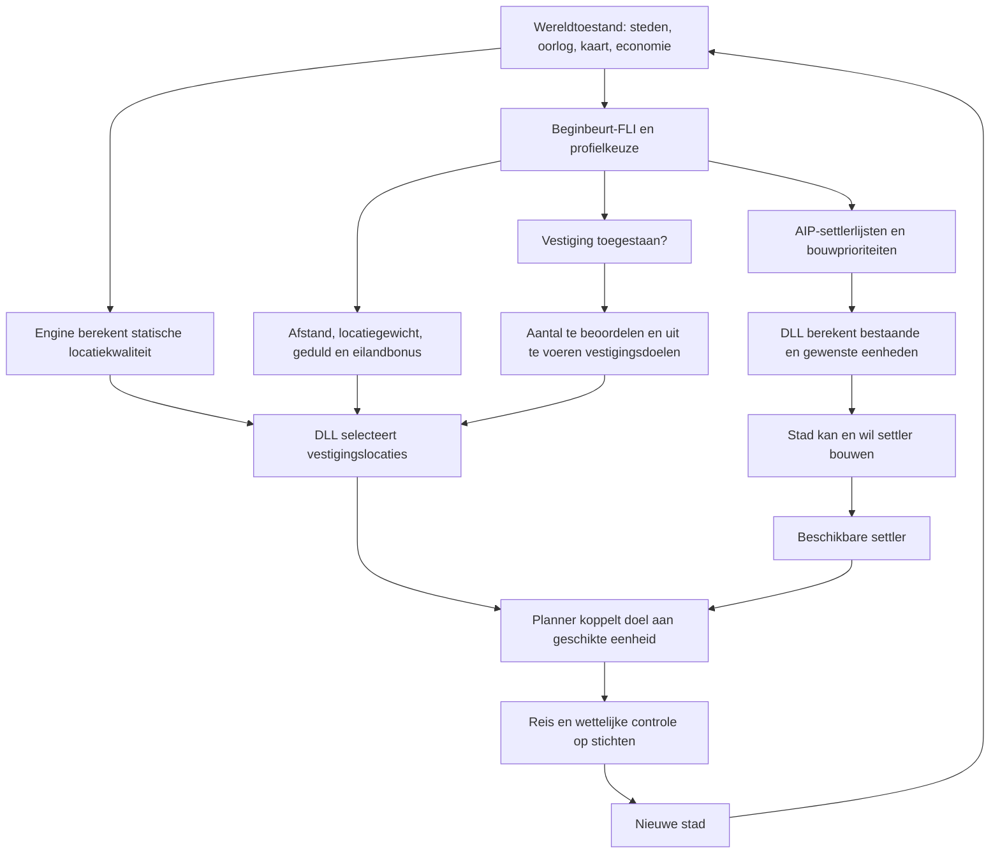

# Hoe de bestaande AI steden sticht

**Vervolg na de T60-proef:** [VESTIGINGSDOELEN.md](VESTIGINGSDOELEN.md) onderzoekt de machinecode van de overeenkomende AI-DLL. Daarmee zijn negatieve goallimieten (vaste aantallen), de aftrekking voor city_delta en het uitsluitingsmasker achter packing vastgesteld. De eerdere onzekerheden daarover hieronder zijn historische stand van onderzoek. De aanwezige civctp.map past qua timestamp niet bij civctp.exe; engine-adressen uit die map zijn geen geverifieerde adressen van de huidige executable.

Onderzoek van de lokale CTP I-bestanden op 2 oktober 2026. Referentie CTP-og; AAIP dient als vergelijking. Geen gameplaywijziging voor deze analyse. De kleinere quotaproeven zijn op verzoek gestopt; oorspronkelijke proef-AIPs hersteld en proefgame afgesloten.

## Wat zichtbaar is

De FLI-regels en AIP-instellingen zijn leesbaar. De algoritmes voor het berekenen van locatiekwaliteit, eenheidsvraag, taaktoewijzing en daadwerkelijk stichten zitten in civctp.exe en robotcom.dll. In de werkmap zijn geen implementatiebestanden met extensie .cpp/.cxx/.cc aangetroffen. Aipdef.h beschrijft invoerstructuren. De linker-maps bevatten functienamen en adressen, geen functie-inhoud of aanroepvolgorde.

Onderstaande keten is daarom een reconstructie: de voorwaarden in FLI/AIP zijn direct controleerbaar; de verbinding tussen interne functies is afgeleid uit hun namen en interfaces. Een volledige exacte beslisboom vereist onderzoek van de gecompileerde functies. Zekerheden en open vragen worden hier gescheiden.

## Overzicht

Dit is geen bewezen volgorde van alle interne aanroepen. Vooral settlerproductie en beschikbare vestigingsdoelen zijn verschillende onderdelen; een hogere vraag naar settlers garandeert geen snellere stichting.

## 1. Welk uitbreidingsbeleid wordt aangevraagd?

De normale beginbeurtroutes bevatten persoonlijkheidsflags, inputs/outputs, set_settle_density en economische regels, gevolgd door aiploader. Voorbeeld: [beginturnSciMany.fli](../CTP-og/ctp_data/default/aidata/beginturnSciMany.fli:1).

In [aiploader.fli](../CTP-og/ctp_data/default/aidata/aiploader.fli:77) wordt masssettle aangevraagd wanneer:

- zero_at_war actief is;
- een van a48_96_map, a70_140_map of a64_128_map actief is;
- een van a1_num_cities, a2_num_cities of a3to5_num_cities actief is;
- het niveau niet Chieftain/Warlord/Prince is, dus de normale Deity-route.

De actie laadt masssettle bij mass_settle_aip > 0.8. Bij dezelfde kaart/stadsvoorwaarden op de drie lagere niveaus wordt masssettle_sandbag gevraagd. Zodra found_early_aip onvoldoende actief is, vragen de persoonlijkheidsregels hun normale profiel aan. Op first_turn worden persoonlijkheidsprofielen bovendien afzonderlijk aangevraagd, ook als een vroege aanvraag bestaat. Verschillende loads kunnen dus samen voorkomen; de effectieve overschrijfvolgorde is niet uitgelezen.

Dit is geen regel 'blijf uitbreiden tot 25–30 steden'. De masssettle-aanvraag richt zich op fuzzy sets voor circa 1–5 steden. De economische opening in set_food_or_prod heeft daarnaast eigen regels voor circa 1–9 steden. Die twee openingsbegrippen zijn niet hetzelfde.

### Verdachte kaartsets

[inputs.fli](../CTP-og/ctp_data/default/aidata/inputs.fli:282) definieert:

| Naam | Centrum size_of_world | Breedteparameter | Kaartafmetingen in Const |
| --- | ---: | ---: | --- |
| a48_96_map | 4608 | 250 | Medium: 48 × 96 |
| a64_128_map | 1152 | 250 | Large: 64 × 128 = 8192 |
| a70_140_map | 8192 | 250 | Gigantic: 70 × 140 = 9800 |

De naam a64_128_map heeft hetzelfde centrum als de kleine kaartset; a70_140_map heeft het product van de Large-afmetingen. Als size_of_world het product van de geconfigureerde afmetingen is, herkent de loader onze Gigantic-kaart niet als zo'n uitbreidingskaart. Dit is een concrete inconsistentie en een belangrijke onderzoekskandidaat, geen bewezen runtimefout: de engineberekening van size_of_world is nog niet uitgelezen. Afmetingen: [Const.txt](../CTP-og/ctp_data/default/gamedata/Const.txt:297). De betrokken inputs en loader zijn gelijk in AAIP; de mod lost dit niet aantoonbaar op.

## 2. Hoeveel settlers wil de AI bouwen?

Eenheidsvraag komt uit meerdere lijsten, niet uit een gewenst eindtotaal steden. In masssettle:

| Lijst | Prioriteit | UNIT_SETTLER-waarde |
| --- | ---: | ---: |
| Land_Settler_Troops_Primary | 10500 | -2 |
| Settler_Troops_Core | 3500 | -3 |
| Settler_Troops_Overflow | 3000 | -2 |

De concurrent Scout_Troops_Primary heeft prioriteit 25000. Volgens het lokale commentaar krijgen primary-eenheden voorrang op gebouwen/wonders; core wordt verweven en krijgt voor de eerste gevraagde eenheid een hogere score. Dit is uitleg van het ontwerp, geen garantie dat iedere stad onmiddellijk dezelfde lijst afwerkt. Zie [masssettle.aip](../CTP-og/ctp_data/default/aidata/AIPs/masssettle.aip:20).

Aipdef.h noemt de waarde units_per_city. De negatieve interpretatie is niet beschreven. De map toont precies de relevante interne routines:

- AIP::Update_Actual_Units;
- AIP::Choose_Unit_From_List;
- AIP::Update_Desired_Units;
- AIP::Add_Supplemental_Unit_Build_Goals;
- Goal_Build_List::Compute_Raw_Priority en Execute_Task;
- CityAgent::CanBuildUnit en EstimateRoundsToBuildUnit.

Bron: [robotcom.map](../CTP-og/ctp_program/ctp/dll/ai/robotcom.map:2213). Dit geeft concrete aanknopingspunten om later de quotaformule te onderzoeken, maar verklaart die formule nog niet. Hoe bestaande, onderweg en in productie zijnde settlers worden geteld, en hoe primary/core/overflow samengaan, blijft open.

De bouwbaarheid en het tempo tellen ook mee. Default stelt max_build_unit_rounds op 20. De settler kost 540 shields en heeft BUILDING_REMOVES_A_POP; bevolking en haar herstel zijn dus onderdeel van herhaalde productie. De exacte behandeling van grootte 1 volgt niet alleen uit deze vlag. [units.txt](../CTP-og/ctp_data/default/gamedata/units.txt:294). Economische regels beïnvloeden voedsel, werkers, WGF, PW-belasting en dus de gerealiseerde productie. Een hoge eenheidsvraag maakt deze middelen niet groter.

### Wat de recente proef werkelijk zegt

De baseline, -20 en +20 hebben op T20 elk drie steden en één losse settler. Maar baseline bouwt in Cardiff een Granary en in Swansea een Phalanx; bij beide extreme varianten bouwen deze steden weer een Settler. Op T10 is Cardiff bij ±20 bovendien drie resterende bouwbeurten verder dan de baseline en ontbreekt de extra Phalanx. De quota heeft dus wel een waargenomen effect op bouwkeuze en timing. De telling op T20 bewijst geen afwezig effect op productie, noch hetzelfde verdere uitbreidingstempo. Volledig bewijs: [quotareeks](../PROEVEN/settlerquota/reeks/RESULTATEN.md).

## 3. Wanneer worden vestigingsdoelen uitgezet?

De loader reageert op neg3toneg1_city_delta of neg3minus_city_delta met yes_no_settling_aip. Bij no_settling_aip > 0.75 wordt no_settle geladen. Dat profiel zet MAX_EVAL_SETTLE_GOALS én MAX_EXEC_SETTLE_GOALS op 0. Zonder deze aanvraag kan yes_settle worden geladen; dat stelt de waarden op -30 en -5. [aiploader.fli](../CTP-og/ctp_data/default/aidata/aiploader.fli:322), [no_settle.aip](../CTP-og/ctp_data/default/aidata/AIPs/no_settle.aip:8), [yes_settle.aip](../CTP-og/ctp_data/default/aidata/AIPs/yes_settle.aip:8).

De tekst plaatst city_delta onder 'happiness penalty'. De input is echter alleen gedeclareerd: de precieze engineformule en of zij een actuele of geprojecteerde marge gebruikt zijn niet zichtbaar. Niet zonder bewijs gelijkstellen aan gemiddeld stadsgeluk of exact 'regeringslimiet minus aantal steden'.

De regeringsregels geven wel een duidelijke samenhang:

| Regering | TOO_MANY_CITIES_THRESHOLD | COEFFICIENT |
| --- | ---: | ---: |
| Tyranny | 10 | 1 |
| Monarchy | 20 | 1 |
| Theocracy | 40 | 0.5 |

Bron: [govern.txt](../CTP-og/ctp_data/default/gamedata/govern.txt:79). Deze parameters onderbouwen waarom richting 25–30 steden ook regering/geluk moet worden meegenomen. Ze zijn geen harde fysieke grens aan het stichten van een stad.

Een tweede rem beperkt vroege voorsprong op de mens, maar geldt alleen bij Chieftain/Warlord/Prince. Op Deity is dat geen toepasselijke verklaring. De header 'ONLY STOP SETTLING AFTER OPENING' wordt niet afgedwongen door een openingsvoorwaarde in de daadwerkelijke if op regels 395–399; commentaar alleen bewijst geen vrijstelling tijdens de opening.

Oorlogsregels start_war en phase1–4 zetten build_no_settlers. Dit stuurt output no_settling; het is een andere variabele dan no_settling_aip. Die twee mogen niet als één stop worden behandeld. De exacte koppeling van no_settling aan de DLL-bouwbeslissing is nog te volgen. Phase5 zet die instructie niet in zijn eigen blok. [outputs.fli](../CTP-og/ctp_data/default/aidata/outputs.fli:6), [aiploader.fli](../CTP-og/ctp_data/default/aidata/aiploader.fli:252).

MAX_EVAL/EXEC zijn grenzen aan taken die de planner beoordeelt/uitvoert, geen gewenst eindtotaal steden. De toelichting in default beschrijft positieve waarden als per-stadlimieten. De negatieve interpretatie blijft onbewezen: -5 dus niet meteen lezen als 'maximaal vijf steden in het rijk'.

## 4. Waar wil de AI stichten?

Er zijn twee zichtbare delen van locatiebeoordeling.

**Engine:** civctp.map noemt RobotInterface::RawStaticFP, StaticSettlePoint, StaticSettle, InitStaticSettle en GetSettleValue, plus C3World::GetSettleValue. Locatiekwaliteit komt dus mede uit de spelengine, niet uitsluitend uit de AI-DLL. De naam RawStaticFP suggereert een rol voor voedsel/productie; de gebruikte formule en het meewegen van goods, kust, bergen en overlap zijn hiermee niet bewezen. Bron: [civctp.map](../CTP-og/ctp_program/ctp/civctp.map:5620).

**AI-DLL:** AiMap::GroundBuildSettleTree, FlattenCanSettle, FlattenStaticSettle, InsertBestSettleGoal, InsertSettleGoals en CleanSettleQueue wijzen op selectie van kandidaatlocaties en vestigingsdoelen. ArmyAgent::PretestSettle, ActionBidToSettle, GoalSettle::Compute_Raw_Priority en ArrivedAtTask verbinden een geschikte eenheid aan zo'n taak. ArmyAgent::ActionSettle en engine CanSettle/ArmySettle bestaan eveneens. De map geeft hun implementatie en onderlinge aanroepen niet. Bron: [robotcom.map](../CTP-og/ctp_program/ctp/dll/ai/robotcom.map:2581).

De tekstregels leveren daarvoor aansturing:

| Instelling | Originele waarden | Wat direct vaststaat |
| --- | --- | --- |
| settler_packing | Centra 3 / 3.5 / 4 / 4.5; default 4 | Commentaar: gewenste gemiddelde afstand tussen steden, geen wettelijke minimumafstand |
| settle_value_coef | 0.1 / 6 / 10 | Modes watch_for_enemies / default_behavior / get_best_spot; exacte scorewerking onbekend |
| settle_patience | 25 / 100 / 500 | Modes short / normal / long; niet aangetoond dat dit rechtstreeks wachtbeurten zijn |
| settle_bonus_island | Default 0, actief centrum 100000 | Bij full_continent_except_friends wordt eilandbonus aangevraagd |
| distance_from_unit_priority_modifier | -5 bij count <5; -500 bij count >5 | lowdist/highdist; count niet zonder bewijs gelijkstellen aan spelbeurt |
| settle_priority | Default 17000000 | Algemeen gewicht van vestiging; geen formule voor afzonderlijke tiles |

Bronnen: [outputs.fli](../CTP-og/ctp_data/default/aidata/outputs.fli:232), [set_settle_density.fli](../CTP-og/ctp_data/default/aidata/set_settle_density.fli:35), [aiploader.fli](../CTP-og/ctp_data/default/aidata/aiploader.fli:239), default/lowdist/highdist.aip.

Dichte persoonlijkheden vragen in vrede normaal get_best_spot aan, losse default_behavior. Bij survival/oorlog vragen regels watch_for_enemies en, voor dichte vestiging, long patience. Sommige voorwaarden kunnen tegelijk actief zijn; fuzzy uitkomsten zijn geen simpele exclusieve branches. De losse regel op regel 8 heeft bovendien gemengde and/or zonder buitenste haakjes; parserprecedentie is niet vastgesteld. set_settle_density wordt vóór aiploader opgenomen: dit bewijst geen eenvoudig gedrag 'eerst nieuwste survivalflag bepalen, dan locatiegewichten berekenen'.

Als het continent inclusief bevriende aanwezigheid voller wordt, vraagt de loader naval bij >0.65 en supernaval bij >0.9. Bij full_continent_except_friends komt de eilandbonus erbij. Deze profielen bevatten ook eenheidslijsten. Bereikbaarheid, transportcapaciteit en doelkeuze moeten dus samen worden bekeken.

Er staat in deze keten geen zichtbare expliciete regel voor onze definities 'drie bewerkbare bergen', 'drie voedseltiles' of 'meerdere identieke goods plus vier aanvoergoederen'. Dat sluit intern meewegen van terrein/goods niet uit; het specifieke gewenste model is hier niet aangetoond.

## 5. Wat leert AAIP?

aiploader en masssettle zijn gelijk aan origineel. AAIP verandert wel locatiegedrag: packing-centra worden alle 3.7; de dichte één-stadregel wordt dense in plaats van truly_dense; get_best_spot wordt vervangen door default_behavior, en patience wordt aangepast. Daarmee is locatieaansturing een aantoonbaar bestaande modmogelijkheid. Of dit snellere stichting of betere locaties geeft moet worden gemeten; de moddoelstelling om minder op te vullen kan botsen met onze voorkeur voor dichte goede steden.

AAIP corrigeert tevens yes_can_sea_settle: origineel gebruikt daarvoor per ongeluk de variabele can_space_settle, AAIP gebruikt can_sea_settle. Dit is een concreet verschil in inputbinding. In de vroege Deity-vergelijking is de lagere-niveaurem die deze set gebruikt niet relevant, dus dit niet als verklaring van onze huidige uitkomst presenteren.

AAIP geeft de AI vijfmaal langere tijdslimieten (25/250/3000 naar 125/1250/15000 ms). Meer taakvraag op een grote kaart kan ook door rekentijd worden begrensd. De limieten bestaan aantoonbaar; dat onze proef deze bereikt is niet gemeten. Geen automatische overname van deze wijziging.

## Conclusie en gericht vervolg

Het aantal steden is de uitkomst van herhaalde settlerproductie, toegestane vestigingsdoelen, geschikte bereikbare locaties en uitvoering. In de onderzochte regels is geen gedeeld einddoel van 25–30 steden zichtbaar. Hogere primary-quota verandert slechts één deel van die keten.

Het nuttigste verdere codeonderzoek richt zich op:

1. De runtimebetekenis van size_of_world en de verdachte kaartsets, zodat duidelijk is of masssettle op Gigantic überhaupt wordt gevraagd.
2. De herkomst van city_delta en de koppeling aan de regering, plus de aparte no_settling-bouwrem.
3. AIP::Update_Desired_Units/Update_Actual_Units voor exacte quotatelling en de combinatie van lijsten.
4. RobotInterface::StaticSettlePoint en AiMap::InsertBestSettleGoal voor terrein/goods, afstand en hoeveel vestigingsdoelen worden aangemaakt.

Deze functies zijn gecompileerd. Hun exacte beslissingen moeten met passende binaire analyse of gerichte runtimewaarneming worden vastgesteld. Tot die tijd mogen de zichtbare instellingen wel als aangrijpingspunten worden gebruikt, maar niet als een volledig bekende beslisboom. Eerst deze remmen uitzoeken; geen verdere ±10/±5-run en geen gameplaywijziging zonder een concrete onderbouwde oorzaak.
