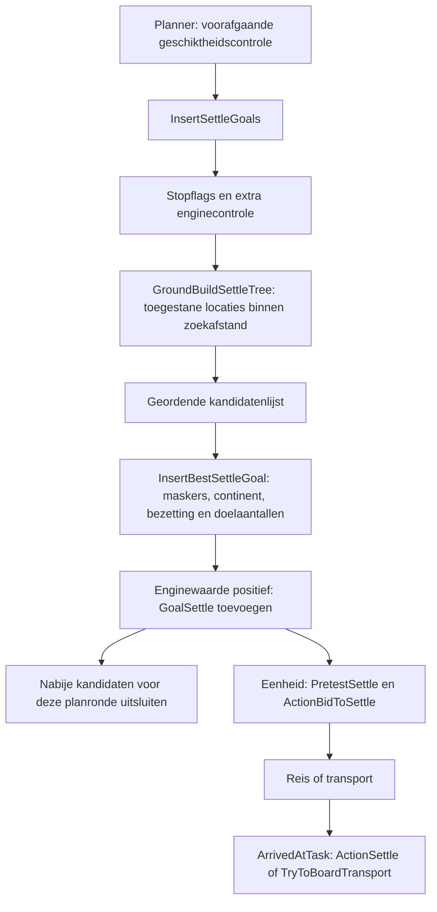

# Vestigingsdoelen: regels en machinecode van CTP I

Onderzocht op 2 oktober 2026 naar aanleiding van de drie T60-saves. Geen gameplaybestanden gewijzigd en geen beurten gespeeld. Dit verdiept en corrigeert [UITBREIDING-BESLISKETEN.md](UITBREIDING-BESLISKETEN.md): enkele eerdere onzekerheden zijn nu uit de oorspronkelijke AI-DLL vastgesteld.

## Nieuwe zekerheden

1. Negatieve AIP-goallimieten zijn vaste aantallen; niet-negatieve limieten worden met het stadsantal vermenigvuldigd en naar boven afgerond.
2. `city_delta = max_cities_before_penalty - num_cities` in de AI-DLL. Het is geen gemiddeld stadsgeluk.
3. `settler_packing` wordt bij registratie van een nieuwe eigen stad gebruikt om kandidaatlocaties rond die stad te verwijderen. Het is meer dan alleen een zacht afstandsgewicht.
4. De planner maakt vestigingsdoelen aan via een kandidatenlijst, past filters en limieten toe en voegt geaccepteerde locaties als `GoalSettle` toe. De eenheid moet daarna nog een geldig bod doen en het doel uitvoeren.
5. Scheepsbouw en settlerbouw concurreren binnen de bestaande primary-lijsten. Een marineprofiel garandeert geen gebouwd transportschip.

Dit verklaart mogelijke mechanismen achter de settlervoorraden, maar stelt nog niet vast welke rem bij elke T60-beschaving actief was. De saves tonen geen uitgelezen FLI-waarden, doelenlijsten of individuele afgewezen biedingen.

## Bewijs en reproduceerbaarheid

De originele `robotcom.dll` en `robotcom.map` hebben dezelfde timestamp `37b894e7` en imagebase `20000000`. DLL SHA256: `3025070D66FBA516E4CDD70AE332055E1E4EF5162BF1B14C163B9BD128A35D44`. De machinecode is alleen gelezen, met Capstone 5.0.9 en pefile via [Analyseer-AI-DLL.py](../PROEVEN/Analyseer-AI-DLL.py). Afzonderlijke functie-disassemblages en adressen staan onder [BINAIR](BINAIR/vestigingslimieten-en-goal.txt).

Een belangrijke beperking: de aanwezige **civctp.exe en civctp.map hebben verschillende timestamps**, respectievelijk `37d6f702` en `37b89a6b`. Adressen uit die engine-map zijn daarom niet geschikt om zonder verdere verificatie de huidige executable te disassembleren. Een verkennende vtable-resolutie is verworpen; zie [afwijking](BINAIR/regeringsgrens-interface.txt). Het analysescript weigert nu een timestamp/imagebase-mismatch. Functienamen in die oude engine-map blijven historische aanknopingspunten, geen bewezen adreskoppeling aan de aanwezige executable.

De resultaten hieronder komen uit de wél overeenkomende AI-DLL en haar map. Disassemblage is geen volledige broncode: onbekende veldnamen, enumwaarden en indirecte engine-aanroepen blijven expliciet onbekend. Ingebedde springtabellen kunnen als instructies worden weergegeven; die regels zijn geen uitgevoerde programmacode. Xrefs zijn zoekhulpmiddelen, geen bewijs van afwezigheid van alle andere toegangspaden.

## 1. Grenzen aan vestigingsdoelen

`AIP::Update_Max_Goals` op `200654c0` haalt het stadsantal op. Voor normale waarden verwerkt het zowel evaluatie- als uitvoeringslimieten als volgt:

```text
als waarde < 0: limiet = ceil(-waarde)
anders:        limiet = ceil(waarde * max(1, stadsantal))
```

Er bestaat daarnaast de speciale sentinel `UNLIMITED = -999999`; die wordt niet als een normaal vast aantal behandeld. Bij nul steden zijn er speciale overrides. Dit verandert de volgende interpretatie voor onze bestaande rijken niet.

| Profiel | Invoer evaluatie | Invoer uitvoering | Betekenis bij een bestaand rijk |
| --- | ---: | ---: | --- |
| default | -80 | -5 | Maximaal 80 beoordelen, 5 uitvoeren |
| yes_settle | -30 | -5 | Maximaal 30 beoordelen, 5 uitvoeren |
| no_settle | 0 | 0 | Geen vestigingsdoelen beoordelen/uitvoeren |
| Denkvoorbeeld | 2 | 0.5 | Bij 10 steden: 20 beoordelen, 5 uitvoeren |

Bron: [Update_Max_Goals](BINAIR/vestigingslimieten-en-goal.txt), instructies `2006552b–20065565` en `20065582–200655b0`; tekstwaarden in default/yes_settle/no_settle.aip. Dit zijn plannerlimieten, geen maximumaantal steden in het rijk en geen garantie op vijf stichtingen per beurt. De precieze taaklevensduur en herhaalde scheduler-rondes moeten nog worden gevolgd voordat we dit naar stichtingen per beurt vertalen.

Belangrijk: de loader kan het gedeeltelijke `yes_settle`-profiel aanvragen en daarmee de evaluatieruimte van 80 naar 30 zetten. Welke effectieve limieten een specifieke AI op T60 heeft, is niet gemeten. Deze waarden automatisch verhogen is daarom nog niet onderbouwd.

## 2. De gelukrem heeft een bekende inputformule

`FSFuzzyBeginTurnPre::Execute` schrijft op `20035079` de engine-uitkomst naar `fz_max_cities_before_penalty`, trekt op `2003507f` `fz_num_cities` af en schrijft op `20035085` `fz_city_delta`. Daarmee staat de aftrekking nu vast. De voorafgaande indirecte engine-aanroepen leveren de marge; hun concrete interface-implementatie is vanwege de engine-mapafwijking niet rechtstreeks bevestigd.

De loader gebruikt negatieve city_delta-sets om `no_settle.aip` te vragen. Die sets en de grens `no_settling_aip > 0.75` zijn fuzzy aansturing; niet reduceren tot een ongeteste harde regel zoals 'bij elf steden stopt Tyranny'. De ondersteunde regeringsparameters in govern.txt blijven relevante aanknopingspunten: Tyranny threshold 10, Monarchy 20 en Theocracy 40. De precieze gelijkstelling van de engine-uitkomst aan die tabelwaarde moet nog worden bevestigd.

Cruciaal: `no_settle.aip` wijzigt **alleen** de vestigingsdoellimieten, geen settlerbouwlijsten. Het kan daardoor samengaan met een grote settlervraag. Dit is een aantoonbare structurele mogelijkheid tot ophoping; nog geen bewezen oorzaak van de Welsh-situatie met slechts drie steden.

Bronnen: [inputberekening](BINAIR/vestigings-inputs-en-afstand.txt), [aiploader](../CTP-og/ctp_data/default/aidata/aiploader.fli:322).

## 3. Drie verschillend benoemde stops

| Mechanisme | Wat vastgesteld is |
| --- | --- |
| `no_settling_aip` → no_settle.aip | Loader zet evaluatie/uitvoering van vestigingsdoelen op nul |
| `no_settling` | Afzonderlijke FLI-output, door oorlogsfases geactiveerd; DLL leest die bij aanvullende eenheidsbouwdoelen |
| `no_settle` | Afzonderlijke DLL/FLI-binding; `InsertSettleGoals` keert onmiddellijk terug als deze waarde groter is dan 0.99 |

`InitFuzzyOut` registreert `no_settle` en `no_settling` als **verschillende** namen en verschillende geheugenadressen. In de onderzochte originele FLI-bestanden is geen expliciete outputdeclaratie/schrijvende regel voor de exacte naam `no_settle` gevonden. Daaruit volgt niet dat de geheugenwaarde nooit elders wordt beïnvloed.

Bij `no_settling > 0.8` gebruikt `AIP::Add_Supplemental_Unit_Build_Goals` een unitdatabase-predicate om bepaalde eenheidstypen over te slaan. De namen en regelcontext wijzen op een settlerbouwrem; de identiteit van die indirecte predicate is nog niet geverifieerd. De verschillende stops mogen dus niet als één flag worden behandeld.

Bronnen: [fuzzy-bindingen](BINAIR/fuzzy-bindingen.txt), [bouwstop](BINAIR/vestigings-bouwstop-en-packing.txt), `InsertSettleGoals` op `2007aaf6–2007ab0d`.

## 4. Hoe een locatie een taak wordt

Deze delen van de keten zijn nu in de DLL teruggevonden:



`FindAllGoalPos` roept `PretestSettle` aan en daarna `InsertSettleGoals`, met een gecachte limiet; een negatieve sentinel wordt op die plek vervangen door 200. `GroundBuildSettleTree` toetst kandidaatbits, haalt afstand tot het eigen rijk op en verwerpt locaties buiten een intern zoekbereik. In `InsertSettleGoals` kan dat bereik bij weinig kandidaten worden verruimd, tot 50. Beginwaarde, coördinatenbetekenis en bereik in de T60-saves zijn niet vastgesteld.

`InsertBestSettleGoal` haalt kandidaten uit een priority queue, toetst een veranderlijk toestemmingsmasker, gebruikt engine-uitkomsten voor aanwezige spelers/eenheden en houdt tellingen per continent bij. Een landcontinent zonder eigen landlegers krijgt in dit codepad niet onbeperkt extra doelen: na de eerste kandidaat kan een volgende worden geweigerd. De waterroute heeft een vergelijkbaar leger/tellingsfilter. Een positieve enginewaarde wordt als locatiekwaliteit in een nieuwe `GoalSettle` opgeslagen en via `Planner::Add_Goal` toegevoegd. Daarna wordt rond die gekozen kandidaat tijdelijk radius 1 uit het masker verwijderd.

Onbenoemde indirecte enginechecks worden niet als volledig bekende regels voor terrein of diplomatie gepresenteerd. Het exacte meewegen van mountains, goods, stadsoverlap en ons production/science-model is nog niet gereconstrueerd.

Bronnen: [planneraanroep](BINAIR/vestigings-planneraanroep.txt), [selectie](BINAIR/vestigingsselectie.txt), adressen `2007a1ba`, `2007a9a6`, `2007aa5f–2007aabb`.

## 5. Packing sluit daadwerkelijk locaties uit

Vervolgonderzoek: [VESTIGINGSMASKER.md](VESTIGINGSMASKER.md) stelt de hieronder nog onbekende savelevensduur vast: de bits blijven bewaard en worden bij laden niet met de nieuwe packing herberekend. Eigen stadsregistraties gebruiken packing; buitenlandse gebruiken vast radius 3. De precieze omzetting naar zichtbare afstanden blijft open.

Bij `RegisterMyAddCity` neemt de DLL `max(1, settler_packing)`, zet dit om naar een integer en roept `FlattenStaticSettle` rond de nieuwe stad aan. Die routine roept `FlattenCanSettle` op het statische land- of ruimtemasker aan. Deze wist kandidaatbits binnen de meegegeven radius, in interne kaartcoördinaten, met wrap aan kaartgrenzen.

Dat betekent dat een mooie nabijgelegen locatie door het **AI-masker** kan verdwijnen, ook als het spel daar wettelijk een stad zou toelaten. De commentaartekst 'target average distance' beschrijft deze concrete uitsluitingswerking onvoldoende. De exacte vertaling naar de zichtbare isometrische vakjes en het opnieuw opbouwen van maskers na save laden moeten nog worden onderzocht. Een wijziging in packing hoeft reeds uitgesloten locaties daarom niet onmiddellijk terug te brengen.

Dit is een direct relevant aangrijpingspunt voor ons doel: goede production/science/monopoly-locaties mogen dichter bij bestaande steden liggen. AAIP zet packing-centra op 3.7; omdat de DLL een integerconversie uitvoert, mag 3.7 niet zonder verder onderzoek worden behandeld als een nauwkeurige afstand van 3,7 vakjes.

Bronnen: `200047d1–20004802` in [packingregistratie](BINAIR/vestigings-bouwstop-en-packing.txt), [maskerwrapper](BINAIR/packing-masker.txt), `FlattenCanSettle` in [maskerbewerking](BINAIR/vestigings-inputs-en-afstand.txt).

## 6. Waardering, geduld en uitvoering

`GoalSettle::Compute_Raw_Priority` telt de algemene vestigingsprioriteit en de generieke ArmyGoal-score op bij `locatiekwaliteit * settle_value_coef` en een typegebonden bonus, waaronder `settle_bonus_island`. Een hogere eilandbonus maakt een eilanddoel aantrekkelijker; ze creëert geen transportschip.

`ActionBidToSettle` controleert eerst geschiktheid, gebruikt reisafstand en bewegingskosten, toetst continent/bereikbaarheid en kan het bod afwijzen met -1e9. `settle_patience` zit in een kwadratische factor in de bodberekening, met een ondergrens van 0.5; het is **geen directe opdracht om 25/100/500 beurten te wachten**. De volledige betekenis van alle termen is nog niet uitgewerkt.

Ook is er een afwijzing bij `GetLandSettlers >= 10` voor twee interne ArmyAgent-statuswaarden (1 en 2). De statusbetekenis is nog niet vastgesteld: dit mag niet worden beschreven als een algemene regel 'tien settlers blokkeren verdere vestiging'.

Bij aankomst bestaat een daadwerkelijk transportpad: `GoalSettle::ArrivedAtTask` roept voor subtaak 0 `ActionSettle` aan en voor subtaak 2 `TryToBoardTransport`. Daarom zijn de nullen bij aparte TRANSPORT_GOALS in default.aip op zichzelf **geen bewijs** dat settlertransport onmogelijk is.

## 7. Waarom transportschepen kunnen ontbreken

Aanvullende reconstructie: [RUIMTE-BUREN-TRANSPORT.md](RUIMTE-BUREN-TRANSPORT.md). Deze stelt de eenheidsquotaformule vast en werkt continentvolheid, overlap met andere beschavingen en defensieroutes verder uit. De hieronder genoemde eerdere onzekerheid over de gewogen formule is daarmee gedeeltelijk opgelost; de engine-continentmaat en feitelijke T60-input blijven nog onbekend.

Normale primary-lijsten: Land_Settler_Troops_Primary 10500, Sea_Troops_Primary 5000. Naval/supernaval verhogen de zeeklasse naar 6000, nog steeds onder de settlerklasse. De originele naval-primary vraagt onder meer Triremes -2; AAIP verandert die Triremevraag naar 0.4. De hoeveelheid en de klasseprioriteit zijn afzonderlijke instellingen.

De loader vraagt naval bij `land_continents_full_of_friends > 0.65`, supernaval bij >0.9. Dit is geen expliciete regel 'we hebben settlers zonder bereikbaar doel, maak transport'. De DLL-berekening van continentvolheid telt eigen steden en aanwezige settlerlegers mee, en in een parameterafhankelijke route ook buitenlandse steden. Veel settlers kunnen dus mede invloed hebben op de input voor de marinekeuze; de precieze gewogen formule en haar T60-waarde zijn nog niet volledig gereconstrueerd.

Daarmee is een plausibele samenhang zichtbaar: een grote onvervulde primary-settlervraag verdringt scheepsbouw, terwijl kandidaten of bereikbaarheid beperkt blijven. De T60-Welsh hebben elf/twaalf settlers, drie steden en geen schip; de baseline zeven steden en drie Triremes. Dit past bij die hypothese, maar bewijst nog niet alle tussenstappen.

## Conclusie en volgende gerichte stap

De vijf uitvoeringsdoelen zijn geen overtuigende hoofdverklaring voor slechts drie Welsh-steden na zestig beurten. Er zijn concretere kandidaten: uitsluiting van nabije locaties door packing, onvoldoende transport en eventuele vestigingsstops. De stadsgelukrem verdient aandacht bij grotere rijken, maar is zonder uitgelezen city_delta geen aangetoonde verklaring voor Welsh.

Onderzoek als eerstvolgende stap de **maskeropbouw bij initialisatie/save laden en de vertaling van packing naar zichtbare stadsafstand**. Daarmee kunnen we een kleine, afzonderlijke locatieproef ontwerpen, zonder opnieuw extreme quota of handmatig geplaatste steden te gebruiken. Houd settlerquota, regering en transportbeleid in die proef gelijk; beoordeel bereikbare geschikte locaties, settlervoorraad en daadwerkelijke stichting. Daarna transport als eigen wijziging. Voorlopig zijn alleen analyses en hulpmiddelen toegevoegd.
